# Sistema Multiagente CoALA

## Sumário

1. [O que é um Agente?](#o-que-é-um-agente)
2. [Modelo CoALA](#modelo-coala-cognitive-architectures-for-language-agents)
3. [Classe Base AgenteCoALA](#classe-base-agentecoala)
4. [Agente de Interpretação de Intenção](#agente-de-interpretação-de-intenção)
5. [Agentes de Saúde (8)](#agentes-de-saúde-8)
6. [Agente de Orçamento por Subfunção (até 7 instâncias)](#agente-de-orçamento-por-subfunção-até-7-instâncias)
7. [Agentes Analíticos](#agentes-analíticos)
8. [Agente de Contexto Orçamentário](#agente-de-contexto-orçamentário)
9. [Arquitetura Estrela](#arquitetura-estrela)
10. [Arquitetura em Árvore](#arquitetura-em-árvore)
11. [Regras de Negócio](#regras-de-negócio)
12. [Uso de LLM — resumo](#uso-de-llm--resumo)

> Para o passo a passo de cada topologia, com o código de cada ação, ver [arquitetura/arquitetura-estrela.md](arquitetura/arquitetura-estrela.md) e [arquitetura/arquitetura-arvore.md](arquitetura/arquitetura-arvore.md). Para a classe base e as chamadas ao LLM, ver [arquitetura/agente-coala-e-llm.md](arquitetura/agente-coala-e-llm.md).

> **Diagramas:** as figuras deste documento ficam em [`docs/diagramas/agentes/`](diagramas/agentes/), em PNG (300 dpi) e SVG, prontas para a monografia: até 16 × 9 cm, texto em Arial 12 quando inseridas a 100%, sem título nem legenda dentro da imagem. Convenção: retângulo branco = ação ou processo; arredondado cinza-claro = dado; cinza = componente externo (Neo4j, LLM, WebSocket); borda ou seta tracejada = etapa opcional, alternativa ou retorno. Para regenerar: `python docs/diagramas/agentes/gerar_diagramas_agentes.py`.

---

## O que é um Agente?

Um **agente** é um programa autônomo que percebe o ambiente, toma decisões e age para atingir objetivos. Diferente de uma função comum, que recebe input e retorna output, um agente tem:

- **Autonomia**: decide sozinho o que fazer
- **Reatividade**: responde a mudanças no ambiente
- **Proatividade**: age para atingir objetivos, não só reage
- **Estado interno**: mantém memória e planos de ação

Neste projeto, cada agente é uma classe Python que herda de `AgenteCoALA` e se especializa numa tarefa: interpretar a intenção do usuário, consultar um sistema de informação de saúde, consultar o orçamento de uma subfunção, calcular correlações e anomalias, priorizar achados etc.

---

## Modelo CoALA (Cognitive Architectures for Language Agents)

O modelo **CoALA** (Sumers, Yao, Narasimhan & Griffiths, 2023, arXiv:2309.02427) organiza agentes baseados em LLM em três dimensões: como armazenam informação (memória), qual o espaço de ações disponível (internas e externas) e como decidem o que fazer (um loop de percepção, proposta, avaliação e execução).

### Memória — quatro sistemas

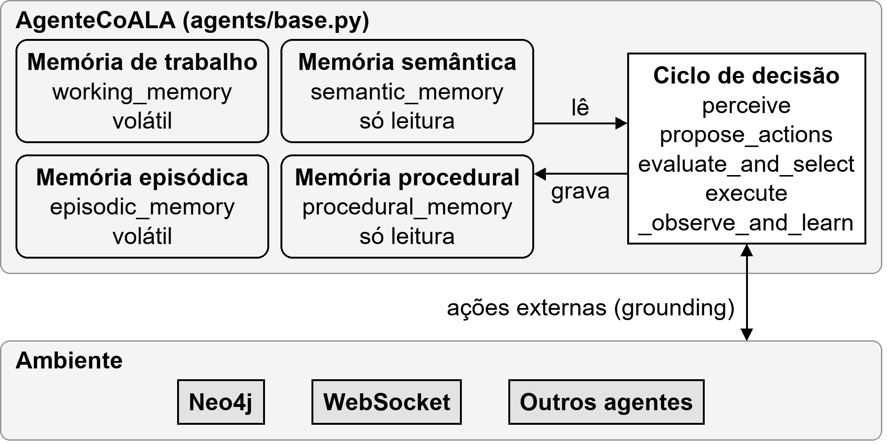

| Memória | Papel | No código |
|---------|-------|-----------|
| **Working** | Buffer ativo de curto prazo: parâmetros da análise, resultados parciais | `working_memory: dict` |
| **Semantic** | Fatos/regras de domínio (subtipos de um sistema, dimensões válidas, limiares, polaridade de indicadores), preenchidos no `__init__` e lidos por *retrieval* explícito — em `propose_actions`, em `evaluate_and_select` e dentro das próprias ações `_act_*` | `semantic_memory: dict` |
| **Episodic** | Histórico de ações executadas (sucesso e falha), gravado por `_observe_and_learn`. **Volátil** (descartado com o processo) e nunca lido pelo próprio agente: é trilha de auditoria, não realimentação. O único retrieval episódico do sistema é o do agente de intenção, que recupera análises anteriores do Neo4j — entre sessões | `episodic_memory: list` |
| **Procedural** | "Como fazer": lista ordenada de estratégias por goal (a primeira é a primária, as demais são fallbacks) | `procedural_memory: dict[str, list[Callable]]` |

A `semantic_memory` é o que **fecha o espaço de decisão do LLM**: dimensões válidas, ângulos de ênfase e vocabulário de indicadores são listas que o agente enumera *antes* de perguntar, e qualquer resposta fora delas é descartada. É por isso que o LLM escolhe itens de um menu e nunca escreve Cypher. Os três papéis dessa memória — identidade do agente, menu fechado e regras de interpretação do número —, o inventário do que cada agente sabe e a comparação de aderência ao framework original estão em [arquitetura/agente-coala-e-llm.md](arquitetura/agente-coala-e-llm.md#os-três-papéis-da-memória-semântica).

### Espaço de ações

- **Internas** (reasoning/retrieval/learning): processamento sobre a working memory, leitura de semantic memory, gravação em episodic memory. Inclui chamadas ao LLM para raciocinar sobre o estado atual. Ex.: calcular Spearman, cruzar dados, escolher uma dimensão de consulta, gerar texto.
- **Externas** (grounding): interação com o ambiente: Neo4j, WebSocket, delegação a outro agente. Ex.: consultar `IndicadorSaude` no Neo4j.

### O ciclo CoALA

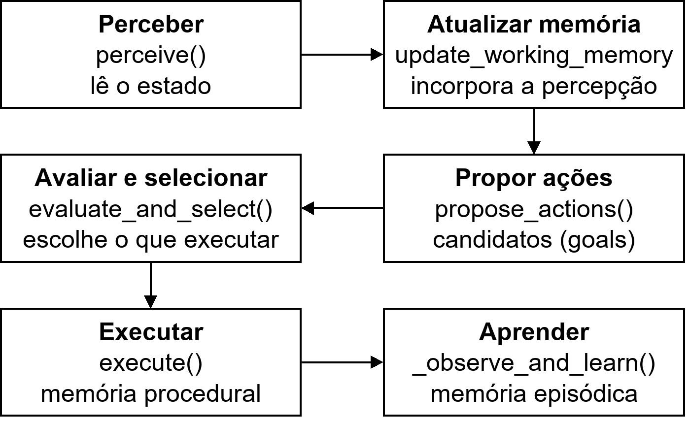

```
PERCEBER → ATUALIZAR WORKING MEMORY → PROPOR AÇÕES → AVALIAR E SELECIONAR → EXECUTAR
   │                                       │                 │                  │
   lê parâmetros               candidatos de ação     escolhe quais     roda cada ação via
   da working memory           (com retrieval de      executar          procedural memory e
                               semantic memory)                         registra o episódio
```

**Exemplo concreto: `AgenteSINAN`**

```
1. PERCEBER:     working_memory tem analysis_id="abc", período 2019–2024
2. ATUALIZAR:    working_memory = {analysis_id, date_from: 2019, date_to: 2024,
                                   intent_summary: "dengue por faixa etária"}
3. PROPOR:       retrieval de semantic_memory["dimensoes_validas"] = [POR_FAIXA_ETARIA, POR_SEXO]
                 → 3 candidatos de "consultar_indicadores":
                   sem quebra | quebra por faixa etaria | quebra por sexo
4. AVALIAR/SEL.: score determinístico ("faixa etaria" aparece na intenção → 1.0)
                 + arbitragem opcional via LLM → escolhe POR_FAIXA_ETARIA
5. EXECUTAR:     Neo4j: IndicadorSaude {sistema:"sinan"} -[:POR_FAIXA_ETARIA]-> FaixaEtaria
                 → working_memory["indicadores"] = [...]
```

### O ciclo no código

```python
# backend/agents/base.py — AgenteCoALA
def run_coala_cycle(self) -> None:
    perception = self.perceive()
    self.update_working_memory(perception)
    candidates = self.propose_actions()
    actions = self.evaluate_and_select(candidates)
    self.execute(actions)
```

A implementação base de `evaluate_and_select` é um passthrough, que seleciona todos os candidatos. Os agentes com **deliberação real** a sobrescrevem: os agentes de saúde com dimensões válidas e o agente de orçamento (escolha de dimensão), além do `AgentePriorizacaoAnalitica` (escolha de ângulo de ênfase). Orquestrador, coordenador e supervisores mantêm o passthrough de propósito: a ordem das macro-ações é imposta por dependência de dados, não por arbitragem.

`execute()` percorre `procedural_memory[goal]` em ordem. Se uma estratégia levanta `ActionFailure`, registra o episódio como falha e tenta a próxima (fallback). Se todas falharem, a ação fica `"failed"` e o laço segue. Essa propriedade sustenta a degradação graciosa em todos os níveis.

```python
# Agente de domínio — procedural_memory com fallback
self.procedural_memory = {
    "consultar_indicadores": [
        self._act_consultar_indicadores,   # primária: consulta o Neo4j
        self._act_fallback_indicadores,    # fallback: working_memory["indicadores"] = []
    ],
}
```

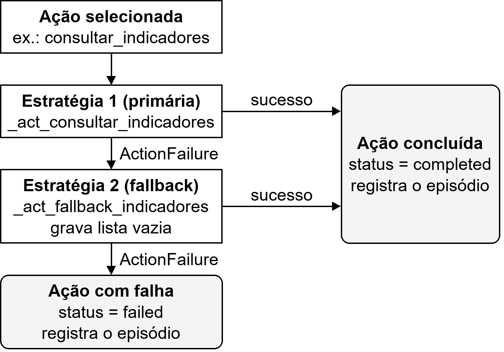

---

## Classe Base AgenteCoALA

**Arquivo:** `backend/agents/base.py`

Todos os agentes herdam desta classe: intenção, saúde, orçamento, analíticos, contexto, além do orquestrador, do coordenador e dos supervisores. A exceção é o `TextSynthesizer`, que é um serviço.

```python
class AgenteCoALA:
    agent_id: str
    working_memory: dict[str, Any]
    semantic_memory: dict[str, Any]
    episodic_memory: list[dict]
    procedural_memory: dict[str, list[Callable[[dict], None]]]
    _failed_actions: list[dict]

class ActionFailure(Exception):
    def __init__(self, action: dict, reason: str): ...
```

| Método | O que faz |
|--------|-----------|
| `perceive()` | Lê o ambiente/working memory |
| `propose_actions()` | Gera candidatos de ação (`{"goal": ...}`) |
| `evaluate_and_select(candidates)` | Seleciona o que executar (passthrough por padrão) |
| `_act_*(action)` | Estratégia de uma ação, registrada em `procedural_memory` |
| `_act_fallback_*(action)` | Estratégia alternativa (dados parciais em vez de falha) |

### Padrão de IDs

Formato `{topologia}-{papel}-{uuid_hex[:8]}`:

```
star-orch-1a2b3c4d             ← OrquestradorEstrela
star-sinan-a1b2c3d4            ← agente de saúde SINAN na estrela
star-orcamento-305-e5f6g7h8    ← agente de orçamento da subfunção 305
hier-coord-9z8y7x6w            ← CoordenadorGeral
hier-sup-saude-m3n4o5p6        ← SupervisorSaude
hier-analitico-q7r8s9t0        ← AgenteAnalitico na árvore
intent-9f8e7d6c                ← agente de intenção (um por sessão de chat, fora das topologias)
```

---

## Agente de Interpretação de Intenção

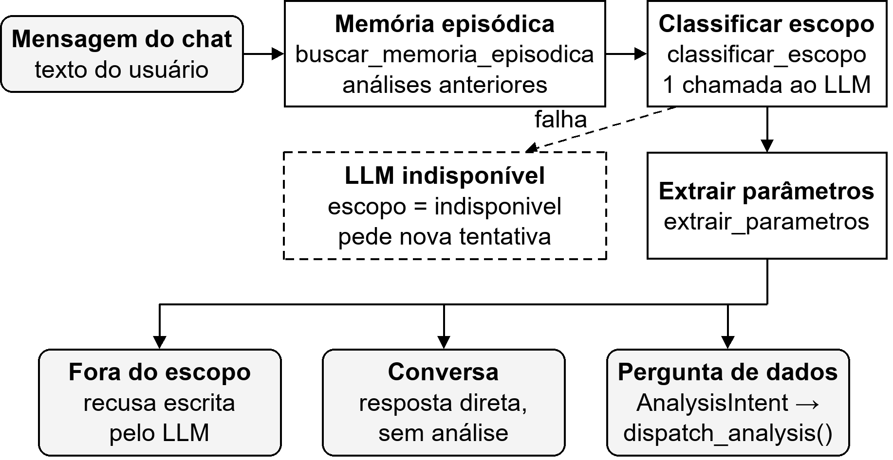

**Arquivo:** `agents/intent/agente_interpretacao_intencao.py`

É a porta de entrada do sistema. Cada mensagem do chat (`WS /ws/chat/{sessionId}`) passa por ele **antes** de qualquer topologia ser instanciada. **Não há regex**: toda mensagem passa pelo LLM.

**Ações do ciclo:**

| Ação | Tipo | O que faz |
|------|------|-----------|
| `buscar_memoria_episodica` | Externa | Recupera as últimas análises (`Analise` no Neo4j, via `get_past_analises`) e as grava como episódios. Só quando há `neo4j_client` |
| `classificar_escopo` | Interna (LLM) | **Única chamada LLM**: classifica a mensagem em 3 vias e, se for pergunta de dados, já extrai os parâmetros na mesma resposta JSON |
| `extrair_parametros` | Interna | Copia os parâmetros já extraídos para a working memory. É ação própria para que o guardrail apareça como passo auditável em `episodic_memory` |

**Classificação em 3 vias:**
- `em_escopo=false`: assunto não relacionado, recusado com resposta escrita pelo próprio LLM.
- `em_escopo=true, precisa_analise=false`: saudação, "o que você faz?" e afins. Responde direto, sem disparar análise.
- `em_escopo=true, precisa_analise=true`: pergunta de dados. Extrai parâmetros e dispara a análise.

**Fallback:** se o LLM falhar, `_act_fallback_classificar_escopo` grava `escopo = "indisponivel"`. É uma falha técnica, com mensagem distinta de uma recusa de escopo.

**Inferência "natural":** sem período explícito, usa todo o intervalo disponível (`min_year`/`max_year` vindos de `GET /api/data-range`). Sem tema explícito, usa todos os indicadores válidos. As flags `date_range_inferred`/`health_params_inferred` registram a suposição.

**Saída — `AnalysisIntent`:**

```python
@dataclass
class AnalysisIntent:
    date_from: int
    date_to: int
    health_params: list[str]        # tokens de VALID_HEALTH_PARAMS
    intent_summary: str             # resumo de 1 frase, insumo da deliberação dos agentes
    date_range_inferred: bool
    health_params_inferred: bool
```

`VALID_HEALTH_PARAMS` contém os tokens que ativam agentes: `dengue`, `covid`, `vacinacao`, `internacoes`, `mortalidade`, os demais 8 agravos do SINAN, `nascidos_vivos`, `producao_ambulatorial` e os 12 subtipos do CNES.

**Segurança:** a mensagem do usuário é tratada como dado, nunca como instrução, para mitigar prompt injection. A resposta do LLM passa por parsing JSON estrito, aceitando só as chaves esperadas.

---

## Agentes de Saúde (8)

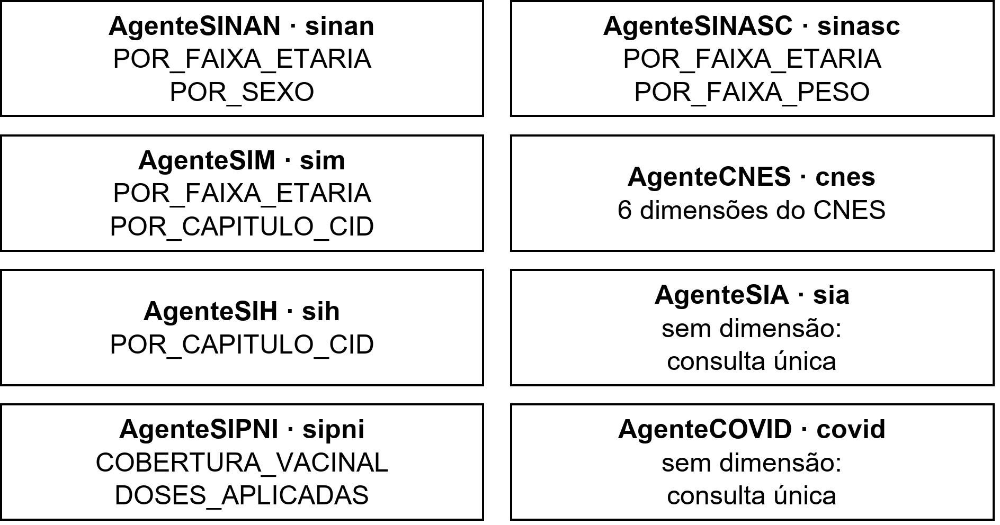

Um agente por **sistema de informação do DATASUS**, todos em `agents/domain/`. Cada um consulta `IndicadorSaude {sistema: <sis>}` no Neo4j via `neo4j_client.get_indicadores_por_sistema`. **Nenhum consulta despesas**: orçamento é responsabilidade do `AgenteOrcamentoSubfuncao`.

| Agente | Arquivo | `sistema` | Subtipos | Dimensões válidas (deliberação) |
|--------|---------|-----------|----------|---------------------------------|
| `AgenteSINAN` | `agente_sinan.py` | `sinan` | 9 agravos: dengue, chikungunya, sífilis (adquirida/gestante/congênita), coqueluche, hepatites virais, tuberculose, hanseníase | `POR_FAIXA_ETARIA`, `POR_SEXO` |
| `AgenteSIM` | `agente_sim.py` | `sim` | `mortalidade` | `POR_FAIXA_ETARIA`, `POR_CAPITULO_CID` |
| `AgenteSIH` | `agente_sih.py` | `sih` | `internacoes` | `POR_CAPITULO_CID` |
| `AgenteSIPNI` | `agente_sipni.py` | `sipni` | `cobertura_vacinal`, `doses_aplicadas` | `COBERTURA_VACINAL`, `DOSES_APLICADAS` |
| `AgenteSINASC` | `agente_sinasc.py` | `sinasc` | `nascidos_vivos` | `POR_FAIXA_ETARIA`, `POR_FAIXA_PESO` |
| `AgenteCNES` | `agente_cnes.py` | `cnes` | 12 subtipos (leitos, profissionais, estabelecimentos, equipes, equipamentos…) | 6 dimensões (`POR_TIPO_ESTABELECIMENTO`, `POR_OCUPACAO`, `POR_TIPO_EQUIPE`, …) |
| `AgenteSIA` | `agente_sia.py` | `sia` | `producao_ambulatorial` | — (consulta única) |
| `AgenteCOVID` | `agente_covid.py` | `covid` | `casos`, `obitos` | — (consulta única) |

As dimensões válidas vêm de `db/query_builder.py::SISTEMA_DIMENSOES`, carregadas em `semantic_memory["dimensoes_validas"]`.

### Deliberação de dimensão

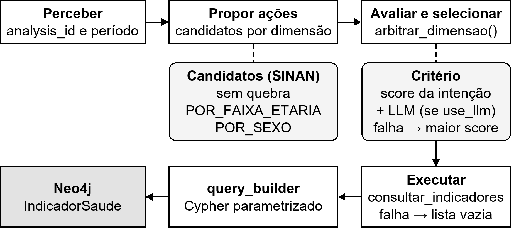

Os agentes com dimensões válidas implementam deliberação real, em dois estágios, compartilhada em `agents/domain/query_planning.py`:

```
propose_actions()                       evaluate_and_select()
─────────────────                       ──────────────────────
propose_dimensao_candidatos()           arbitrar_dimensao()
  → "sem quebra" + 1 por dimensão         1. score determinístico: a dimensão aparece
                                             no intent_summary? (1.0 / 0.0; "sem quebra" = 0.5)
                                          2. use_llm=True → LLM escolhe entre os candidatos
                                             (caller "{agent_id}:arbitrar_dimensao")
                                          3. qualquer falha do LLM → maior score
                                        → só UM candidato é executado (uma consulta ao Neo4j)
```

O LLM decide **o quê** filtrar e **nunca escreve Cypher**. `db/query_builder.py` monta a query parametrizada e só interpola o nome do relacionamento depois de validá-lo contra a allowlist. Uma dimensão inválida cai para "sem quebra".

**Comportamento comum:**
- Interface pública: `query(analysis_id, date_from, date_to, intent_summary=None, health_params=None, use_llm=True)` → `{"indicadores": [...]}`.
- Sem dados, retornam lista vazia sem exceção. Se o Neo4j falhar, o fallback grava lista vazia.
- Cada consulta Cypher é registrada em `neo4j_client.query_log` e anexada ao resultado do agente, de onde a aba técnica do frontend a exibe.

> **Nota:** `query_planning.py` ainda contém `plan_query()` (planejamento de consulta via LLM, controlado pela flag `USE_LLM_QUERY_PLANNING`), da Etapa 2 do [plano de refatoração](historico/PLANO_REFATORACAO.md). Desde a migração do modelo de dados (`f4838d2`), **nenhum agente chama `plan_query`**. A flag não tem efeito no fluxo atual, e o contador exposto em `GET /api/metrics/query-planning-cache` permanece zerado. A decisão equivalente hoje é a deliberação de dimensão acima, controlada por `use_llm`.

---

## Agente de Orçamento por Subfunção (até 7 instâncias)

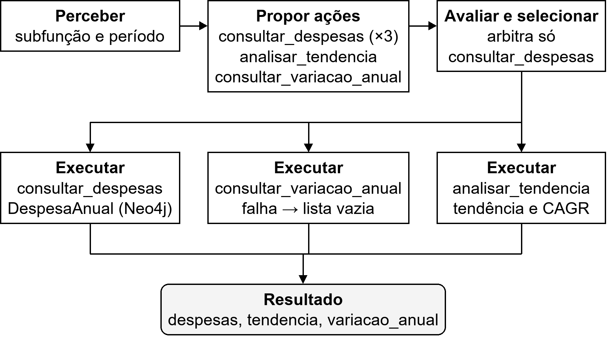

**Arquivo:** `agents/domain/agente_orcamento.py`, classe `AgenteOrcamentoSubfuncao`

Classe **parametrizada** por subfunção (`subfuncao_codigo`, `subfuncao_nome`). As topologias instanciam uma por subfunção relevante à análise, entre 122, 301, 302, 303, 304, 305 e 306. Consulta `DespesaAnual` (`valorProcessado`, execução real) via `get_despesas_por_subfuncao`.

| Goal | Deliberação | O que faz |
|------|-------------|-----------|
| `consultar_despesas` | **Sim**: candidatos "sem quebra" / `POR_NATUREZA` / `POR_APLICACAO`, arbitrados por `arbitrar_dimensao` | Despesas da subfunção no período |
| `analisar_tendencia` | Não | Classifica a tendência do período reaproveitando `AgenteContextoOrcamentario.analyze_trends` |
| `consultar_variacao_anual` | Não | Lê o relacionamento `VARIACAO_ANUAL` pré-computado no ETL (informativo, coexiste com a tendência) |

Como a lista de candidatos mistura três goals, `evaluate_and_select` particiona por goal e só arbitra o grupo `consultar_despesas`.

---

## Agentes Analíticos

Processam dados **em memória**, sem acessar o Neo4j.

### AgenteAnalitico — Correlação (Spearman) + Anomalias

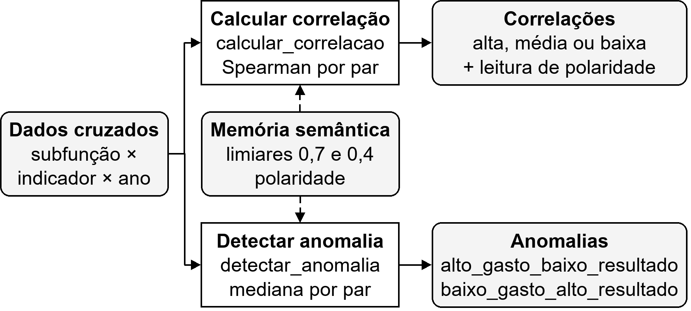

**Arquivo:** `agents/analytical/analitico.py`

Consolida os antigos `AgenteCorrelacao` e `AgenteAnomalias` num único agente CoALA com duas ações de reasoning sobre o mesmo `dados_cruzados`. **100% determinístico (scipy), sem LLM**: correlação e estatística nunca são calculadas pelo LLM.

**`calcular_correlacao`**: Spearman por par (subfunção, indicador). Spearman é baseado em ranks, robusto a outliers e a amostras pequenas.

```
|r| ≥ 0.7  → "alta"     (limiar_alta,  semantic_memory)
|r| ≥ 0.4  → "média"    (limiar_media, semantic_memory)
|r| < 0.4  → "baixa"
```

- Menos de 2 pontos ou arrays constantes → 0.0. Resultado limitado a [-1, 1].
- Cada correlação ganha uma **leitura de polaridade** (`_interpretar_correlacao`), por exemplo "positiva — LEITURA INDESEJÁVEL: mais gasto acompanhou mais casos". Sem isso, o LLM do sintetizador chegou a inverter o sentido de uma correlação gasto × mortalidade.

**`detectar_anomalia`**: compara cada ano com a **mediana** do par, considerando a polaridade do indicador:

| Polaridade | Indicadores |
|------------|-------------|
| Negativos (mais = pior) | `dengue`, `casos`, `obitos`, `internacoes`, `mortalidade` e os demais agravos do SINAN |
| Positivos (mais = melhor) | `cobertura_vacinal`, `doses_aplicadas` — e, por padrão, qualquer indicador fora da lista de negativos: a decisão é `tipo in indicadores_negativos` |

- `alto_gasto_baixo_resultado` (ineficiência): despesa acima da mediana com resultado ruim.
- `baixo_gasto_alto_resultado` (eficiência): despesa abaixo da mediana com resultado bom.
- Pares com menos de 2 pontos válidos são ignorados. Pontos com valor nulo (subtipos que só existem com quebra dimensional) são descartados.

### AgentePriorizacaoAnalitica — Ênfase dos achados

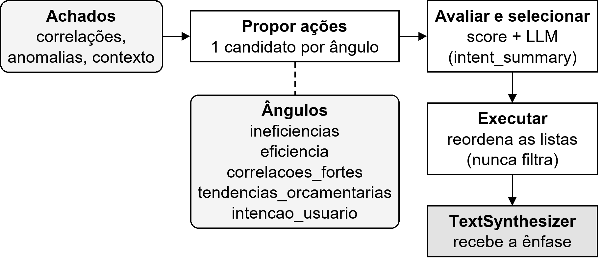

**Arquivo:** `agents/analytical/priorizacao.py`

Decide **qual ângulo enfatizar** e em que ordem apresentar os achados ao sintetizador. **Nunca recalcula nem filtra** correlações ou anomalias, só reordena. Os dados brutos da métrica Q1 ficam intactos.

- `propose_actions`: um candidato por ângulo de `semantic_memory["angulos_possiveis"]`: `ineficiencias`, `eficiencia`, `correlacoes_fortes`, `tendencias_orcamentarias`, `intencao_usuario`.
- `evaluate_and_select`: score determinístico (magnitude e contagem dos achados) e, com `use_llm=True`, um LLM escolhe o ângulo informado pelo `intent_summary`. Em caso de falha, prevalece o maior score.
- Roda **depois** de `capturar_wallclock`, portanto fora do wall-clock comparado entre topologias.

### TextSynthesizer — Geração de texto (serviço, não é agente CoALA)

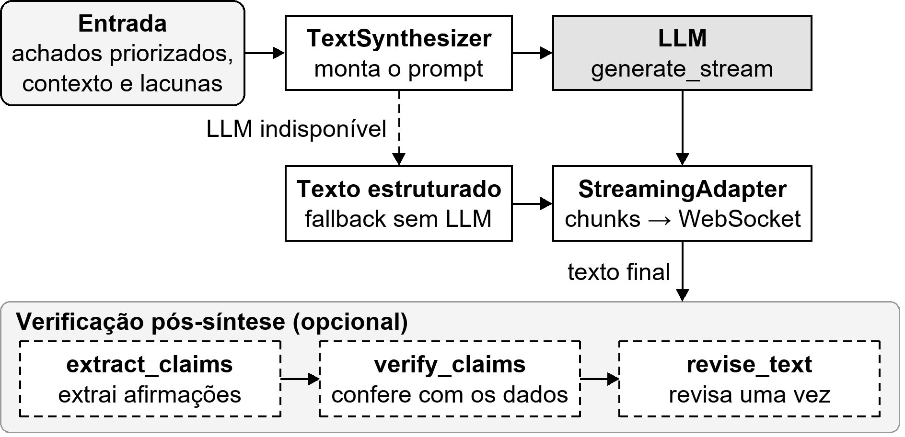

**Arquivo:** `agents/analytical/sintetizador.py`

Não tem memórias próprias nem participa do ciclo. É a implementação de uma ação de reasoning de quem o chama (orquestrador ou `SupervisorAnalitico`). Recebe correlações, anomalias, contexto orçamentário, lacunas e a ênfase escolhida, e gera o texto final em português:

- **LLM disponível**: `generate_stream` emite tokens incrementais, enviados ao WebSocket pelo `StreamingAdapter` (`core/streaming_adapter.py`).
- **LLM indisponível**: `generate_fallback` produz texto estruturado determinístico (resumo, cobertura de dados, correlações, anomalias, contexto orçamentário).

As afirmações que o prompt **fornece** ao modelo (ex.: `CONTEXTO_PANDEMIA`) são constantes de módulo, porque `core/ragas_metrics.py` também as inclui no contexto do juiz de fidelidade.

### Verificação pós-síntese (opcional)

Com `use_self_check=True` (e `use_llm=True`), a ação `verificar_afirmacoes` aplica `core/claim_verifier.py` (Chain-of-Verification): extrai afirmações do texto, verifica cada uma contra os dados brutos e pede **uma** revisão das não suportadas. Nunca lança exceção: qualquer falha preserva o texto original.

---

## Agente de Contexto Orçamentário

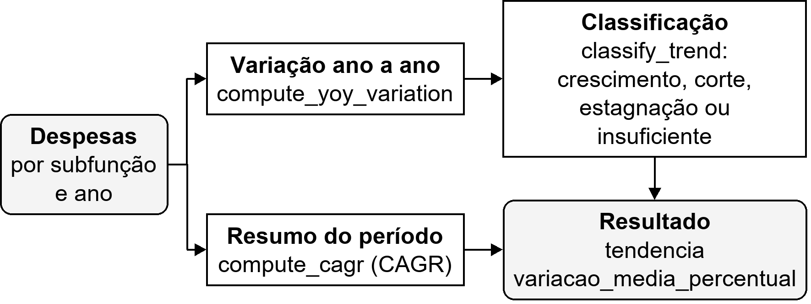

**Arquivo:** `agents/context/contexto_orcamentario.py`, classe `AgenteContextoOrcamentario`

Analisa a evolução do gasto de **todas** as subfunções presentes nas despesas. **100% determinístico, sem LLM.**

- **Variação ano a ano**: `compute_yoy_variation` = `((v_n − v_{n−1}) / v_{n−1}) × 100`. Base zero vira ±∞.
- **Resumo "variação média ao ano"**: **CAGR** ponta a ponta (`compute_cagr`), e não média aritmética das variações. A média simples era dominada por anos de base baixa, como a migração de folha de 301 para 122 em 2020.
- **Classificação** (`classify_trend`, limiares em `semantic_memory`):

| Tendência | Condição |
|-----------|----------|
| `crescimento` | ≥ 2 variações positivas consecutivas |
| `corte` | ≥ 2 variações negativas consecutivas |
| `estagnacao` | Todas as variações com \|v\| < 5% |
| `insuficiente` | Menos de 2 anos de dados |

Sem sequência clara, vale a direção média. `compute_yoy_variation`/`classify_trend` também são usadas pelo ETL para gravar `VARIACAO_ANUAL`, o que garante uma única lógica de classificação no sistema.

---

## Arquitetura Estrela

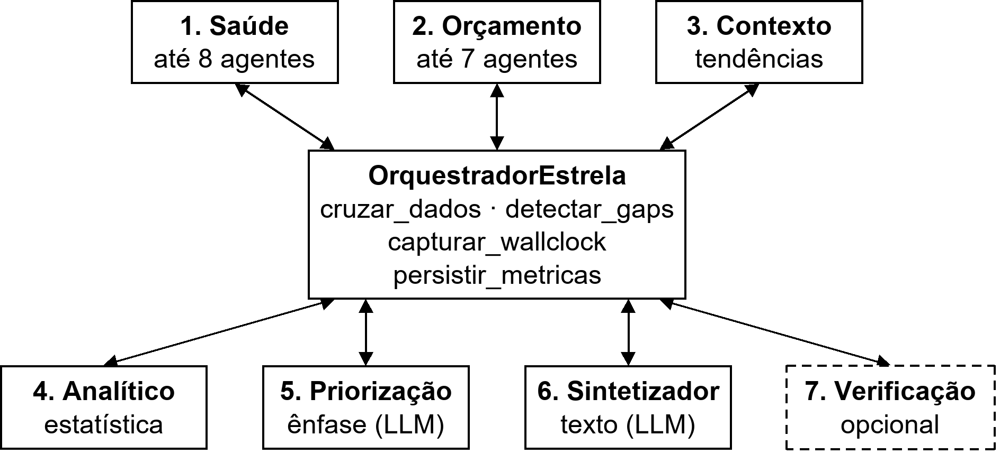

**Arquivo:** `backend/agents/star/orchestrator.py`

Um hub central (`OrquestradorEstrela`) instancia e chama todos os agentes. Nenhum agente periférico se comunica com outro.

```
                                OrquestradorEstrela (hub)
                                          │
   ┌───────────────┬──────────────┬───────┴──────┬──────────────┬──────────────┬─────────────┐
   ▼               ▼              ▼              ▼              ▼              ▼             ▼
Agentes de      Agentes de     Contexto       Analítico     Priorização    Sintetizador   (Verificação)
saúde (≤ 8)     orçamento      orçamentário   (Spearman +   (ângulo)       (LLM,          (opcional)
                (≤ 7, por      (tendências)   anomalias)                   streaming)
                subfunção)
```

### Ativação condicional

Só os agentes relevantes aos `health_params` são instanciados:

- **Saúde**: `INDICADOR_TO_AGENT` mapeia cada token para um sistema (`dengue` e demais agravos → `sinan`; `covid` → `covid`; `internacoes` → `sih`; `vacinacao` → `sipni`; `mortalidade` → `sim`; `nascidos_vivos` → `sinasc`; `producao_ambulatorial` → `sia`; subtipos do CNES → `cnes`).
- **Orçamento**: `_SUBFUNCAO_TOKENS` ativa cada subfunção pelos tokens com par temático: 301 ← SI-PNI · 302 ← SIH · 303 ← SINAN · 304 ← SINAN + `estabelecimentos_vigilancia_epidemiologica` · 305 ← SINAN + COVID · 122/306 ← CNES. `mortalidade` ativa também 301/302/303/305 (é transversal).

### Pipeline (ações em `procedural_memory`)

```
consultar_saude × N      → um agente de saúde por sistema ativado, em sequência
consultar_orcamento × M  → um AgenteOrcamentoSubfuncao por subfunção ativada
cruzar_dados             → deduplicate_despesas + cross_domain_data
detectar_gaps            → detect_data_gaps (cobertura por subfunção/indicador)
analisar_contexto        → AgenteContextoOrcamentario.analyze_trends
analisar                 → AgenteAnalitico.analisar (correlações + anomalias)
capturar_wallclock       → *** fim do trecho determinístico medido ***
priorizar_achados        → AgentePriorizacaoAnalitica
sintetizar_texto         → TextSynthesizer (streaming)
[verificar_afirmacoes]   → só com use_self_check=True e use_llm=True
persistir_metricas       → MetricaExecucao por agente + evento WebSocket
```

**Características:**
- Ponto único de coordenação: tudo passa pelo hub.
- Em falha de um agente, o hub envia um evento `error` pelo WebSocket e continua com dados parciais.
- Overhead de coordenação = `wall_clock − soma dos tempos dos agentes`. Priorização, sintetizador e verificação ficam fora do wall-clock e do breakdown.

---

## Arquitetura em Árvore

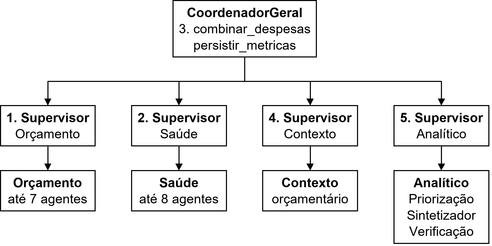

> **Nome no código:** no código e na interface, a topologia em árvore aparece como `hierarchical` (módulo `agents/hierarchical/`, chave `hierarchical` nos eventos e no payload) e como "Hierárquica" nos rótulos da tela e no relatório.

**Arquivos:** `backend/agents/hierarchical/coordinator.py`, `supervisors.py`

Três níveis, organizados como **árvore estrita**: cada supervisor só troca dados com o `CoordenadorGeral` (seu pai), nunca com outro supervisor.

```
                                  CoordenadorGeral (nível 0)
                                            │
       ┌────────────────────┬───────────────┴────┬─────────────────────────┐
       ▼                    ▼                    ▼                         ▼
SupervisorOrcamento   SupervisorSaude     SupervisorContexto       SupervisorAnalitico   (nível 1)
       │                    │                    │                         │
AgenteOrcamento-      agentes de saúde    AgenteContexto-          AgenteAnalitico,
Subfuncao (≤ 7)       (≤ 8)               Orcamentario             AgentePriorizacao,      (nível 2)
                                                                   TextSynthesizer (serviço),
                                                                   verificação (opcional)
```

### Pipeline do `CoordenadorGeral`

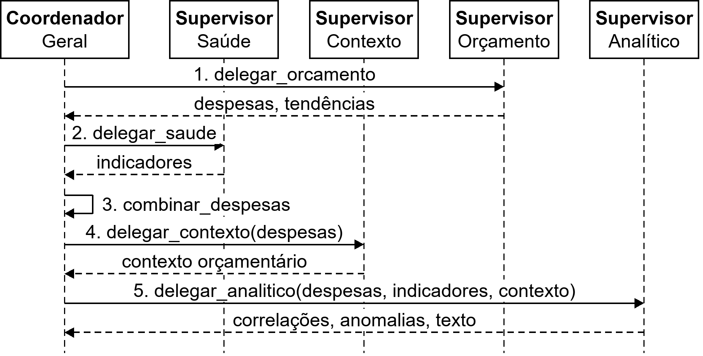

```
delegar_orcamento   → SupervisorOrcamento.run()   → {despesas, tendencias}
delegar_saude       → SupervisorSaude.run()       → {indicadores}
combinar_despesas   → deduplicate_despesas(orçamento + saúde)   (salvaguarda: saúde não traz despesas)
delegar_contexto    → SupervisorContexto.run(despesas=<combinadas>)
delegar_analitico   → SupervisorAnalitico.run(despesas, indicadores, contexto_orcamentario, …)
persistir_metricas  → agentes-folha + 4 supervisores
```

O coordenador colhe o retorno de cada supervisor e o **repassa como parâmetro direto** ao próximo. Não há estado de "dado de par".

### Pipeline dos supervisores

| Supervisor | Ações |
|------------|-------|
| `SupervisorOrcamento` | `consultar_orcamento` × M → `agregar_resultados` |
| `SupervisorSaude` | `consultar_saude` × N → `agregar_resultados` (mesmo `INDICADOR_TO_AGENT` da estrela; com `health_params` vazio ativa todos, mas o agente de intenção nunca envia vazio) |
| `SupervisorContexto` | `executar_contexto_orcamentario` |
| `SupervisorAnalitico` | `cruzar_dados` → `detectar_gaps` → `analisar` → `capturar_wallclock` → `priorizar_achados` → `sintetizar_texto` → [`verificar_afirmacoes`] |

### Métricas e overhead

- O tempo do `SupervisorAnalitico` é medido até o **fim da parte determinística** (`_coala_leaf_end_time`), sem o sintetizador.
- `workers_time_ms` soma só os **agentes-folha** (nível 2). Supervisores aparecem no breakdown, mas não são somados, para evitar contar o tempo duas vezes.
- Overhead = `wall_clock − soma dos agentes-folha`. Captura o tempo dos supervisores fora dos subordinados e a instanciação.

### Degradação graciosa

Se um supervisor falha, o coordenador captura a exceção, envia um evento `error` e segue com um retorno vazio (ex.: `{"despesas": [], "tendencias": {}}`). O resultado final é parcial mas válido, e o texto pode ser gerado pelo fallback.

> **Histórico:** uma versão anterior tinha "comunicação lateral" entre supervisores (`receive_from_peer`/`peer_data`, inclusive com resumos via LLM, Etapa 5 do [plano de refatoração](historico/PLANO_REFATORACAO.md)). Ela foi removida em `38df7be`: com troca de dados entre nós do mesmo nível, a topologia deixa de ser uma árvore no sentido estrito, que é o modelo de hierarquia documentado na literatura.

---

## Regras de Negócio

### Mapeamento subfunção → indicadores (cruzamento)

**Arquivo:** `backend/agents/data_crossing.py` (`SUBFUNCAO_INDICADOR_MAP`)

O cruzamento usa os **subtipos nativos** de cada sistema, e não os tokens de ativação:

| Subfunção | Indicadores cruzados |
|-----------|----------------------|
| 122 Administração Geral | Subtipos do CNES |
| 301 Atenção Básica | `cobertura_vacinal`, `doses_aplicadas` (SI-PNI), `nascidos_vivos` (SINASC) |
| 302 Assistência Hospitalar e Ambulatorial | `internacoes` (SIH), `producao_ambulatorial` (SIA) |
| 303 Suporte Profilático e Terapêutico | 9 agravos do SINAN |
| 304 Vigilância Sanitária | 9 agravos do SINAN + `estabelecimentos_vigilancia_epidemiologica` (CNES) |
| 305 Vigilância Epidemiológica | `casos`, `obitos` (COVID) + 9 agravos do SINAN |
| 306 Alimentação e Nutrição | Subtipos do CNES |
| *mortalidade* (transversal) | Cruza com 301, 302, 303 e 305 |

### Deduplicação de despesas (`deduplicate_despesas`)

Mantém a primeira ocorrência de cada par `(subfuncao, ano)`, preservando a ordem. Hoje é uma salvaguarda, porque só os agentes de orçamento produzem despesas.

### Cruzamento (`cross_domain_data`)

Gera um ponto por (subfunção, indicador, ano) com `valor_despesa` e `valor_indicador`. Com dimensão ativa (`POR_NATUREZA`/`POR_APLICACAO` na despesa, ou qualquer dimensão na saúde), indexa por `(ano, dimensao_valor)`.

### Detecção de lacunas (`detect_data_gaps`)

```python
detect_data_gaps(despesas, indicadores, date_from, date_to, health_params=None)
```

Aponta anos sem despesa ou sem indicador no período, considerando só as subfunções e os indicadores relevantes aos `health_params`. O resultado vai ao sintetizador, para que o texto mencione explicitamente o que falta.

---

## Uso de LLM — resumo

| Agente/serviço | Usa LLM? | Observação |
|----------------|----------|------------|
| `AgenteInterpretacaoIntencao` | **Sim**: uma chamada por mensagem | Guardrail de escopo + extração de parâmetros |
| Agentes de saúde com dimensões (SINAN, SIM, SIH, SI-PNI, SINASC, CNES) | **Opcional** (`use_llm`) | Arbitram a dimensão de consulta. Sem LLM, prevalece o score determinístico |
| `AgenteSIA`, `AgenteCOVID` | Não | Sem dimensões válidas, consulta única |
| `AgenteOrcamentoSubfuncao` | **Opcional** (`use_llm`) | Arbitra a dimensão de `consultar_despesas` |
| `AgenteAnalitico` | Não | Estatística determinística, decisão intencional |
| `AgenteContextoOrcamentario` | Não | Variação percentual/CAGR |
| `AgentePriorizacaoAnalitica` | **Opcional** (`use_llm`) | Escolhe o ângulo de ênfase, fora do wall-clock |
| `TextSynthesizer` | **Sim** | Síntese final, com fallback estruturado |
| Verificação (`core/claim_verifier.py`) | **Sim**, só com `use_self_check` | Até 3 chamadas (extrair, verificar, revisar) |
| Orquestrador, coordenador e supervisores | Não | Coordenação com ordem fixa por dependência de dados |

Pelo chat, `use_llm` é sempre `True` (o toggle saiu do frontend) e `use_self_check` vem do payload da mensagem (`useSelfCheck`, padrão `false`). A avaliação RAGAS usa LLM também, mas fora das topologias (ver [arquitetura/metricas-de-avaliacao.md](arquitetura/metricas-de-avaliacao.md)).
