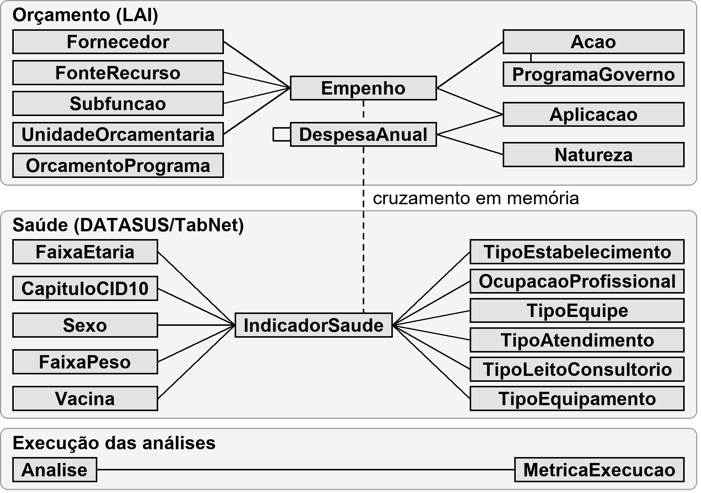
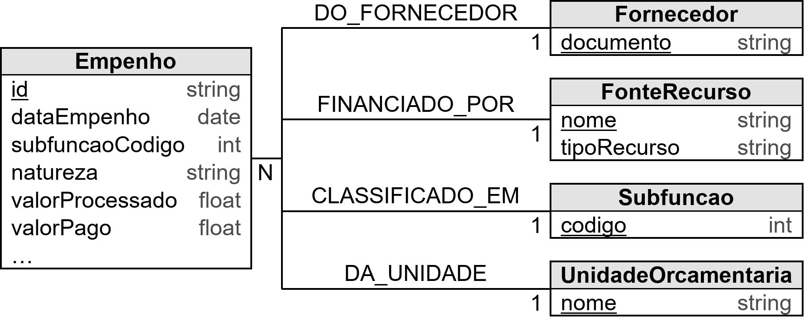
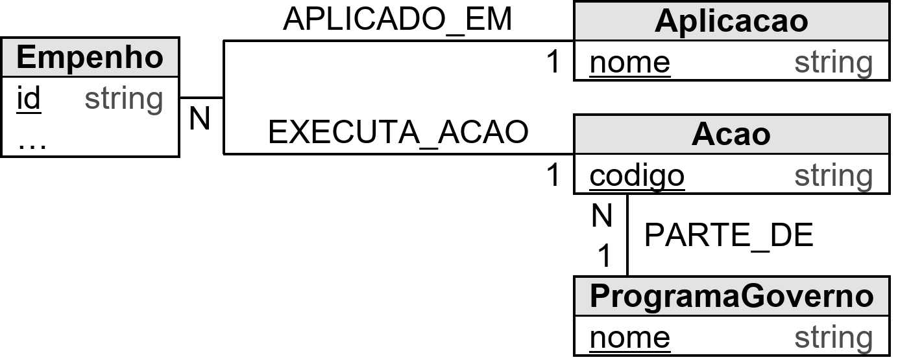
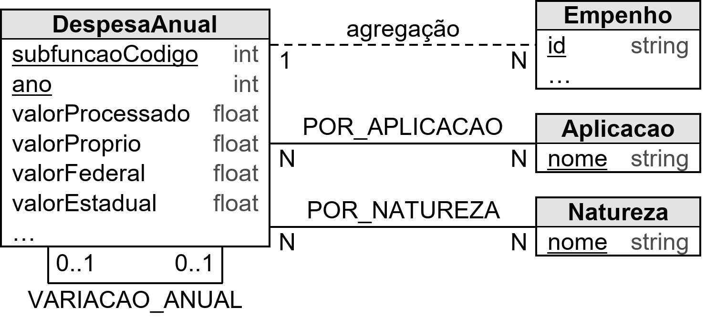
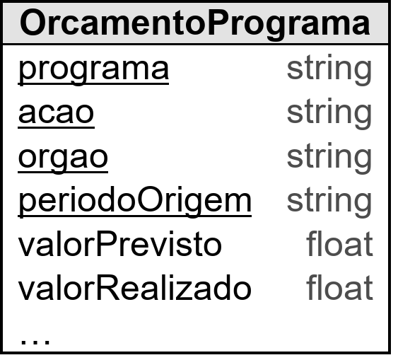
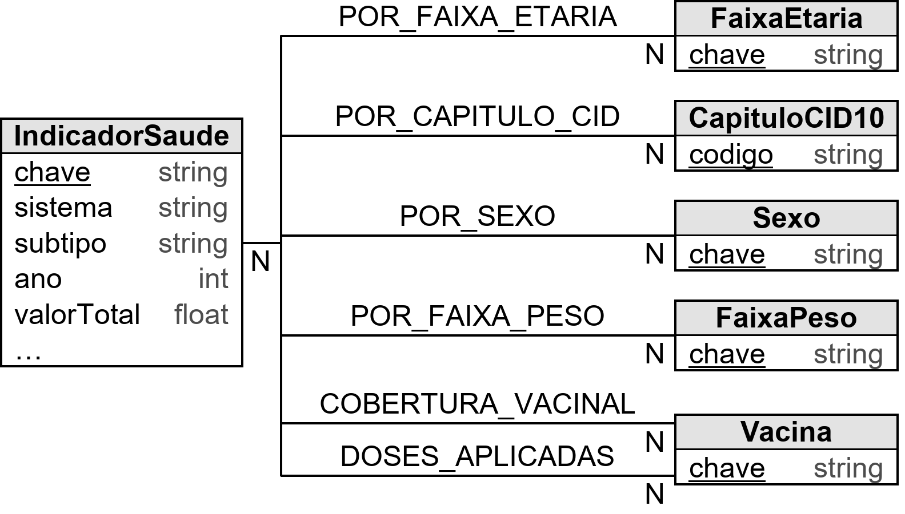
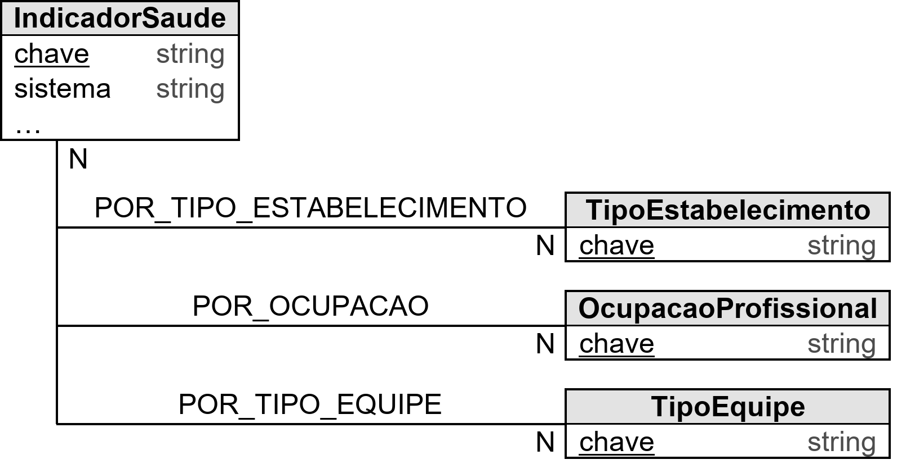
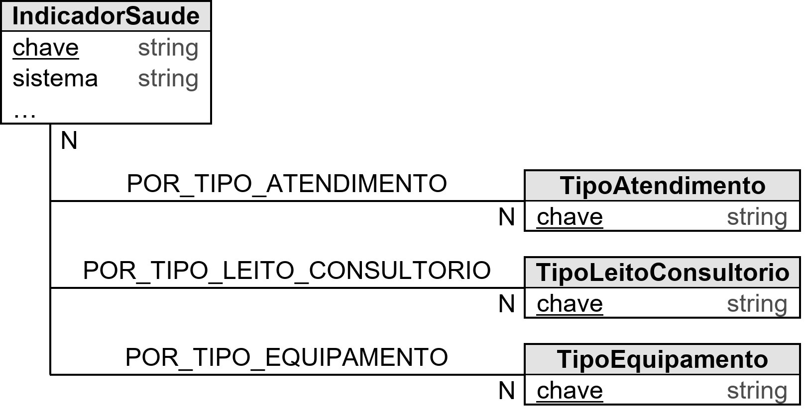
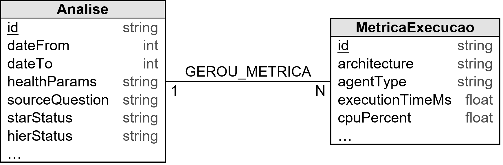

# Fontes de Dados e Pipeline ETL

## Sumário

1. [Visão Geral](#visão-geral)
2. [Origens Institucionais dos Dados](#origens-institucionais-dos-dados)
3. [Janela Temporal](#janela-temporal)
4. [Pipeline ETL](#pipeline-etl)
5. [Diagrama do Modelo de Dados](#diagrama-do-modelo-de-dados)
6. [Modelo de Dados Neo4j — Orçamento](#modelo-de-dados-neo4j--orçamento)
7. [Modelo de Dados Neo4j — Indicadores de Saúde](#modelo-de-dados-neo4j--indicadores-de-saúde)
8. [Nós de Execução e Consultas](#nós-de-execução-e-consultas)
9. [Validações com Dado Real](#validações-com-dado-real)
10. [Limitações Conhecidas](#limitações-conhecidas)

---

## Visão Geral

O sistema lê **exclusivamente arquivos locais já extraídos** em `Dados/` (raiz do repositório) e os persiste num grafo Neo4j. Não há download em tempo de execução: nem FTP do DataSUS nem planilhas do FNS (o pipeline antigo, baseado em PySUS e FNS, foi removido em `b40e328`).

```
Dados/orcamento/{2015-2019,2020-2022,2023-2025}/*.csv     Dados/Sorocaba_DATASUS_2015-2025/*.xlsx
  (execução orçamentária municipal — LAI)                    (extratos DATASUS/TabNet de Sorocaba)
                 │                                                          │
                 ▼                                                          ▼
     backend/etl/orcamento_loader.py                       backend/etl/saude_indicadores_loader.py
                 │                                                          │
                 └──────────────────────────────┬───────────────────────────┘
                                                ▼
                                          Neo4j (grafo)
                                                │
                                                ▼
                     Agentes de domínio (consultas parametrizadas via db/neo4j_client.py)
```

São dois domínios de dados:

| Domínio | Fonte | Granularidade |
|---------|-------|---------------|
| **Orçamento** | Portal de transparência / LAI do município de Sorocaba | Empenho a empenho (execução real, todas as fontes de recurso: própria, federal, estadual, emendas, crédito) |
| **Indicadores de saúde** | DATASUS / TabNet, já filtrado para Sorocaba (IBGE 355220) | Anual por sistema de informação, com quebras dimensionais (faixa etária, capítulo CID-10, vacina, tipo de estabelecimento etc.) |

**Offline-first:** os agentes consultam apenas o Neo4j local durante uma análise, sem APIs externas além do LLM. Isso garante que as duas topologias comparadas processem exatamente os mesmos dados e que os benchmarks sejam reprodutíveis.

---

## Origens Institucionais dos Dados

### Orçamento (`Dados/orcamento/`)

Dois tipos de CSV por bloco plurianual (`2015-2019`, `2020-2022`, `2023-2025`):

| Arquivo | Conteúdo | Vira no grafo |
|---------|----------|---------------|
| `guestuser_lai_-_empenhado_(extraçao_de_dados)_<hash>.csv` | Uma linha por empenho (data, subfunção, natureza, fonte de recurso, fornecedor, ação, aplicação, valores) | `Empenho` + dimensões, agregado em `DespesaAnual` |
| `guestuser_lai_-_previsto_e_empenhado_por_programa_e_secretaria_(extraçao_dados)_<hash>.csv` | Previsto vs. realizado por programa/ação/órgão | `OrcamentoPrograma` |

A proveniência é limitada ao que o nome dos arquivos indica: extração de um portal de transparência/LAI (Lei de Acesso à Informação) de Sorocaba, acessado como usuário convidado. Os CSVs **não têm data de extração embutida**. É uma assimetria real em relação ao lado saúde: se os números do orçamento precisarem ser auditados, não há como saber pelo arquivo quando nem por qual ferramenta foram exportados.

Diferente do pipeline antigo (repasses federais do FNS, que cobriam só a parcela federal do financiamento), esses dados são **execução orçamentária municipal real**. O breakdown por `tipoRecurso` em `DespesaAnual` permite separar recurso próprio de repasse federal/estadual em qualquer consulta.

### Indicadores de saúde (`Dados/Sorocaba_DATASUS_2015-2025/`)

Todas as planilhas têm uma aba **"Notas"** com a proveniência. Município: sempre 355220 (Sorocaba/SP, IBGE 3552205). Datas de extração: 01/08/2026 e 02/08/2026.

| Sistema | Fonte | Ressalvas |
|---------|-------|-----------|
| **SIM** (mortalidade) | TabNet/DATASUS | Dados de **2025 preliminares** (3ª prévia) |
| **SIH** (internações) | TabNet/DATASUS | Dados de **2025 preliminares** (3ª prévia) |
| **SINASC** (nascidos vivos) | TabNet/DATASUS | Dados de **2025 preliminares** (3ª prévia) |
| **CNES — Rede Assistencial** (estabelecimentos por tipo) | TabNet/DATASUS | Dados de **2025 preliminares** (3ª prévia) |
| **SIA** (produção ambulatorial) | TabNet/DATASUS | Total anual = soma de 12 competências mensais; atendimentos processados com atraso "vazam" entre anos adjacentes (comportamento oficial do TabNet) |
| **SINAN** (agravos de notificação) | TabNet/DATASUS | A variável de tempo **varia por doença** (notificação, diagnóstico ou 1º sintoma). Sífilis (adquirida/gestante/congênita) e hepatites virais ainda não têm 2024 e/ou 2025 publicados — atraso normal de consolidação |
| **SI-PNI** (vacinação) | Duas fontes com metodologias diferentes | Ver abaixo |
| **CNES — Recursos** (leitos, profissionais) | TabNet/DATASUS | Variáveis de **estoque** (situação em 31/12). "Profissionais" conta vínculos, não pessoas |
| **CNES — Dados Adicionais** (7 abas) | TabNet/DATASUS | Ver abaixo |
| **COVID-19** | MS (covid.saude.gov.br) + compilação `wcota/covid19br` | Ver abaixo |
| **Bases Indisponíveis** | — | Documentação de cubos checados e indisponíveis (HIPERDIA/SISVAN migraram para e-SUS APS/SISAB; dados financeiros do SUS não têm cubo TabNet público) |

**SI-PNI — o caso mais delicado.** A planilha combina dois períodos:
- **2015–2022**: cubo TabNet legado. O acesso automatizado retornou "Nenhum dado disponível" (base em revisão), então os dados vieram de uma **exportação manual via navegador** (02/08/2026).
- **2023–2026**: painel "Vacinação do Calendário Nacional" (metodologia RNDS), que substituiu o TabNet.
- A **nomenclatura de vacinas não foi unificada** entre os períodos (ex.: `"Meningococo C"` vs. `"Meningocócica Conjugada"`), de propósito, para não supor equivalência.
- Coberturas **acima de 100%** são o que o TabNet retornou (provável denominador populacional desatualizado), não erro de ETL.

**CNES — Dados Adicionais.** A aba de ocupações só tem snapshots de dezembro (consultas com todos os meses davam timeout no TabNet). Há um gap conhecido entre mai/2010 e jan/2012 no sub-cubo de serviço/classificação e uma anomalia em ago/2025 no de equipamentos. Os códigos de equipe mudaram ao longo do tempo (`24 ESF1`/`27 ESF2` até ~2020, `70 ESF`/`71 ESB` depois) e foram mantidos sem unificação.

**COVID-19.** A série termina em março/2023, quando o MS passou o painel para periodicidade semanal. É coerente com a janela do sistema: COVID só tem dado de 2020 a 2023.

---

## Janela Temporal

**Todos os dados, de orçamento e de saúde, ficam restritos a 01/01/2016 – 31/12/2025 (10 anos).** O corte é feito **no ETL**, por linha, e não em tempo de consulta (`PERIODO_ANO_MIN = 2016` e `PERIODO_ANO_MAX = 2025` em ambos os loaders).

Os arquivos de origem extrapolam a janela: os extratos DATASUS começam em 2015 e as doses do SI-PNI vão até 2026, e essas linhas são descartadas. Nos empenhos, os dados reais começam em 2016 apesar da pasta se chamar `2015-2019`.

**Exceção:** `OrcamentoPrograma` não tem coluna de ano por linha. O grão é o bloco plurianual inteiro, mantido integralmente, sabendo que `"2015-2019"` nominalmente inclui 2015.

O endpoint `GET /api/data-range` devolve o intervalo efetivamente carregado (`min`/`max` de `ano` entre `Empenho` e `IndicadorSaude`), usado para validar períodos pedidos no chat.

---

## Pipeline ETL

### Execução automática (Docker)

`docker compose up` já executa o ETL. O `backend/entrypoint.sh`:

```
1. Aguarda o Neo4j responder (até 30 tentativas, 2s entre cada)
2. python -m etl.orcamento_loader            (Dados/orcamento/)
3. python -m etl.saude_indicadores_loader    (Dados/Sorocaba_DATASUS_2015-2025/)
4. exec uvicorn main:app --host 0.0.0.0 --port 8000
```

A falha de um loader é registrada como aviso e não impede o backend de subir. Como a leitura é local e rápida, não há distinção entre modo "cache" e "download".

O `Dockerfile` copia só `backend/` para a imagem. Por isso o `docker-compose.yml` monta `./Dados:/Dados:ro` e define `DADOS_DIR=/Dados` no serviço `backend`. Fora do Docker, os loaders resolvem `DADOS_DIR` com fallback para `../Dados` relativo ao repositório.

### Execução manual (fora do Docker)

```bash
# 1. Subir só o Neo4j
docker compose up neo4j -d

# 2. ETL completo (orçamento + saúde)
cd backend
python run_etl.py

# 3. Ou cada loader individualmente
python -m etl.orcamento_loader
python -m etl.saude_indicadores_loader
```

O `run_etl.py` lê o `.env` da raiz e troca automaticamente o hostname Docker (`bolt://neo4j:`) por `bolt://localhost:`. Ao rodar os módulos diretamente, exporte `NEO4J_URI=bolt://localhost:7687`.

### `orcamento_loader.py`

**Fluxo:**
1. Garante constraints e índices (`CREATE ... IF NOT EXISTS`).
2. Itera `Dados/orcamento/<bloco>/*.csv` e decide o tipo pelo nome (`previsto_e_empenhado` → `OrcamentoPrograma`, `empenhado` → `Empenho`).
3. Lê com pandas (`sep="|"`, `encoding="latin-1"`).
4. Para `Empenho`: filtra a janela, mapeia subfunção/fonte de recurso/fornecedor/ação e persiste em lotes de 2.000 via `UNWIND` (dimensões, nó e relacionamentos numa query por lote).
5. Ao final, quatro agregações sobre o grafo já carregado:
   - `DespesaAnual` por `(subfuncaoCodigo, ano)`, em Cypher;
   - `POR_APLICACAO` e `POR_NATUREZA` (quebras dimensionais de `DespesaAnual`), em Cypher;
   - `VARIACAO_ANUAL` entre anos consecutivos, calculada em Python reaproveitando `compute_yoy_variation`/`classify_trend` de `agents/context/contexto_orcamentario.py`, para que ETL e agente usem a mesma fórmula e os mesmos limiares.

**Mapeamentos:**
- **Subfunção**: texto da planilha → código 122/301–306 (tabela fixa de 7 entradas, sem casos não mapeados nos dados reais).
- **Fonte de recurso → `tipoRecurso`**: tabela fixa de 13 entradas (ver `FonteRecurso` abaixo), com fallback `outros` e log de aviso.
- **Fornecedor**: regex extrai CNPJ ou, na falta dele, CPF; o nome é o texto restante sem tags HTML.
- **Ação**: `"2109-Atencao Primaria em Saude"` → código antes do primeiro hífen, nome depois.
- Todas as 19 colunas do CSV de empenho viram propriedade ou dimensão.

**Idempotência:** só `MERGE`, nunca `CREATE`. Rodar o ETL várias vezes produz o mesmo grafo.

### `saude_indicadores_loader.py`

As planilhas TabNet seguem um padrão (linha 0 = título, linha 2 = cabeçalho, dados a partir da linha 3), mas em quatro formatos com leitores próprios:

| Formato | Leitor | Onde |
|---------|--------|------|
| Ano em linhas, categorias em colunas, `Total` opcional | `_read_wide_sheet(mensal=False)` | SIM, SIH, SINASC, SINAN, CNES (ocupações, estabelecimentos por tipo) |
| `Ano/Mês` em linhas (`"2015/Jan"`) | `_read_wide_sheet(mensal=True)` | Sub-cubos mensais do CNES: só **dezembro** é mantido |
| Ano + uma coluna de valor | `_read_single_valor_sheet` | SIA, CNES leitos, CNES profissionais |
| Transposto (vacina em linhas, ano em colunas) | `_read_vacina_transposta` | SI-PNI |

COVID tem leitores próprios (`_read_covid_anual`, `_read_covid_mensal`), porque traz métricas emparelhadas com acumulados. Linhas cuja chave (ano ou ano/mês) não parseia são puladas, o que descarta rodapés, notas e linhas de totalização.

Há uma função `_load_<sistema>` por sistema (`_load_sim`, `_load_sih`, `_load_sinasc`, `_load_sinan`, `_load_sipni`, `_load_sia`, `_load_covid`, `_load_cnes`). Cada uma persiste `IndicadorSaude` (`MERGE` por `chave`) e as quebras dimensionais em lotes de 2.000. Planilhas que descrevem o **mesmo** fato (ex.: óbitos por faixa etária e por capítulo CID) convergem para o mesmo nó, e cada uma só acrescenta o seu tipo de relacionamento.

---

## Diagrama do Modelo de Dados

O banco é um grafo Neo4j, mas a modelagem é apresentada abaixo como diagrama entidade-relacionamento, com uma entidade por *label* de nó. As figuras ficam em [`docs/diagramas/`](diagramas/), em PNG (300 dpi) e SVG, e foram dimensionadas para a monografia, seguindo os exemplos do Manual de Textos Técnicos:

- largura ≤ 16 cm;
- altura ≤ 9 cm (a visão geral tem 11,3 cm);
- todo o texto em Arial 12 pt, desde que a imagem seja inserida a 100%;
- sem título, fonte ou legenda dentro da imagem, porque isso fica no texto do documento.

Para regenerar depois de mudar o modelo, rode `python docs/diagramas/gerar_diagramas.py`.

**Como ler:**
- **Entidade** = label de nó, com propriedades e tipos. O atributo **sublinhado** é a chave do nó: constraint `UNIQUE` ou, em `DespesaAnual`/`OrcamentoPrograma`, chave lógica composta.
- Os diagramas mostram **só os atributos principais**. Uma linha **"…"** indica atributos omitidos, e as dimensões aparecem só com a chave. A lista completa de propriedades está nas seções [Orçamento](#modelo-de-dados-neo4j--orçamento) e [Indicadores de Saúde](#modelo-de-dados-neo4j--indicadores-de-saúde) abaixo.
- **Linha contínua** = relacionamento gravado no grafo, com o nome do tipo. **1**/**N** = cardinalidade.
- **Linha tracejada** = vínculo lógico **sem** relacionamento no grafo.

Os dois domínios **não são ligados por relacionamentos**. O cruzamento entre gasto e indicador acontece em memória, nos agentes (`agents/data_crossing.py`), por subfunção × subtipo e ano. Na visão geral, ele aparece como a linha tracejada "cruzamento em memória".

### Visão geral



As 25 entidades, agrupadas por domínio. Na visão geral:
- a linha tracejada entre `Empenho` e `DespesaAnual` indica que `DespesaAnual` é calculada a partir dos empenhos;
- o laço em `DespesaAnual` é o relacionamento `VARIACAO_ANUAL`;
- `OrcamentoPrograma` não tem relacionamentos.

### Orçamento — Empenho e classificação



Cada empenho tem exatamente um fornecedor, uma fonte de recurso, uma subfunção e uma unidade orçamentária. `FonteRecurso.tipoRecurso` (`proprio`, `federal`, `estadual`, `credito`, `emenda_parlamentar`, `outros`) é o que permite separar recurso próprio de repasse.

### Orçamento — Empenho, aplicação e ação



`ProgramaGoverno` não se liga ao empenho diretamente, e sim por meio da ação (`PARTE_DE`).

### Orçamento — agregados



`DespesaAnual` é calculada no fim do ETL a partir de `Empenho`, por subfunção e ano. A linha tracejada indica essa agregação, que não é gravada como relacionamento. `POR_APLICACAO` e `POR_NATUREZA` guardam a propriedade `valor`. O laço `VARIACAO_ANUAL` liga o ano atual ao anterior da mesma subfunção e guarda `percentual` e `classificacao`.

### Orçamento — previsto × realizado



`OrcamentoPrograma` fica isolado de propósito: os textos de programa e ação do CSV de previsto × realizado não batem com os de `Acao`/`ProgramaGoverno`.

### Saúde — IndicadorSaude e dimensões



### Saúde — dimensões do CNES





Todos os relacionamentos de quebra do `IndicadorSaude` guardam a propriedade `valor`. As dimensões do CNES são exclusivas desse sistema. Quais quebras cada sistema usa:

| Sistema | Relacionamentos |
|---------|-----------------|
| `sim` | `POR_FAIXA_ETARIA`, `POR_CAPITULO_CID` |
| `sih` | `POR_CAPITULO_CID` |
| `sinan` | `POR_FAIXA_ETARIA`, `POR_SEXO` |
| `sipni` | `COBERTURA_VACINAL`, `DOSES_APLICADAS` |
| `sinasc` | `POR_FAIXA_ETARIA`, `POR_FAIXA_PESO` |
| `cnes` | `POR_TIPO_ESTABELECIMENTO`, `POR_OCUPACAO`, `POR_TIPO_EQUIPE`, `POR_TIPO_ATENDIMENTO`, `POR_TIPO_LEITO_CONSULTORIO`, `POR_TIPO_EQUIPAMENTO` |
| `sia`, `covid` | Nenhum (só `valorTotal`/`valorAcumulado`) |

### Execução das análises



Estes nós são gravados pelo backend a cada análise, e não pelo ETL.

---

## Modelo de Dados Neo4j — Orçamento

> As contagens abaixo vêm da validação de 2026-08-04 (ver [documento histórico](historico/DOCUMENTACAO_ETL_MODELO_DADOS.md)), anterior às agregações `POR_APLICACAO`/`POR_NATUREZA`/`VARIACAO_ANUAL`. Servem como ordem de grandeza.

```
(:Empenho)-[:DO_FORNECEDOR]->(:Fornecedor)
(:Empenho)-[:FINANCIADO_POR]->(:FonteRecurso)
(:Empenho)-[:CLASSIFICADO_EM]->(:Subfuncao)
(:Empenho)-[:APLICADO_EM]->(:Aplicacao)
(:Empenho)-[:EXECUTA_ACAO]->(:Acao)-[:PARTE_DE]->(:ProgramaGoverno)
(:Empenho)-[:DA_UNIDADE]->(:UnidadeOrcamentaria)

(:DespesaAnual)-[:POR_APLICACAO {valor}]->(:Aplicacao)
(:DespesaAnual)-[:POR_NATUREZA {valor}]->(:Natureza)
(:DespesaAnual)-[:VARIACAO_ANUAL {percentual, classificacao}]->(:DespesaAnual)   // ano atual → ano anterior
```

### `Empenho` (~52,9 mil nós)

Um nó por linha do CSV de empenho, sem agregação. A chave de `MERGE` é `id = "{periodoOrigem}:{índice da linha}"`, porque `nroEmpenho`/`nroProcesso` se repetem entre parcelas e estornos.

| Propriedade | Observação |
|-------------|------------|
| `nroEmpenho`, `nroProcesso` | Como vêm da planilha |
| `dataEmpenho` (Date), `ano`, `mes` | Parseado de `DD/MM/YYYY` |
| `subfuncaoCodigo`, `subfuncaoNome` | 122, 301–306 |
| `natureza` | Natureza de despesa (ex.: `3.3.90.30.00-Material de Consumo`) |
| `valorEmpenhoOriginal`, `valorEstorno`, `saldoEmpenho`, `valorProcessado`, `valorPago` | R$ |
| `periodoOrigem` | Bloco de arquivo de origem |
| `fonte` | Sempre `lai_transparencia` |

Soma de `valorProcessado` na validação: **R$ 7,15 bilhões** (2016–2025).

### Dimensões do empenho

| Nó | Chave | Observações |
|----|-------|-------------|
| `Fornecedor` (~2,2 mil) | `documento` (CNPJ **ou** CPF) | ~15–20% dos empenhos são para pessoa física. `tipoDocumento`: `cnpj` \| `pessoa_fisica` \| `desconhecido` (fallback `SEM_DOC:{nome}`) |
| `FonteRecurso` (13) | `nome` (texto literal) | `tipoRecurso`: `proprio` \| `federal` \| `estadual` \| `credito` \| `emenda_parlamentar` \| `outros`. Variantes como `"...vinculados"` vs. `"...vinculados-exec.anter."` não são unificadas: marcam exercício corrente vs. anterior |
| `Subfuncao` (7) | `codigo` | 122 Administração Geral · 301 Atenção Básica · 302 Assistência Hospitalar e Ambulatorial · 303 Suporte Profilático e Terapêutico · 304 Vigilância Sanitária · 305 Vigilância Epidemiológica · 306 Alimentação e Nutrição |
| `Aplicacao` (~330) | `nome` | Dimensão mais específica da finalidade do gasto (ex.: `"Bloco 01 - Assistencia Farmaceutica"`) |
| `Natureza` | `nome` | Criado na agregação `POR_NATUREZA` a partir de `Empenho.natureza` |
| `Acao` (~900) / `ProgramaGoverno` (4) | `codigo` / `nome` | Extraídos do campo `Ação` |
| `UnidadeOrcamentaria` (1) | `nome` | Só `"Secr.da Saude"` |

**`emenda_parlamentar`** é uma categoria própria, de propósito: a variante `"- Leg. Municipal"` (só em 2023–2025) sugere emenda de vereador (recurso municipal), mas as variantes sem qualificador podem ser de deputado/senador (repasse federal).

**Subfunção 122** só aparece a partir de 2020. Antes disso, folha e obrigações patronais ficavam em 301, o que explica o salto de 301 entre 2016 e 2018. É mudança real de prática contábil, não bug do ETL.

### `DespesaAnual` (agregado materializado)

Grão `(subfuncaoCodigo, ano)`, calculado a partir de `Empenho` no fim do ETL. É o que os agentes de orçamento consultam (`neo4j_client.get_despesas_por_subfuncao`).

| Propriedade | Observação |
|-------------|------------|
| `subfuncaoCodigo`, `subfuncaoNome`, `ano` | Índice composto (Neo4j Community não tem constraint composta) |
| `valorProcessado`, `valorPago`, `valorEmpenhado` | Somas de `Empenho` |
| `valorProprio`, `valorFederal`, `valorEstadual`, `valorCredito`, `valorEmendaParlamentar`, `valorOutros` | Breakdown por `tipoRecurso`, que soma exatamente o `valorProcessado` |

Relacionamentos derivados:
- **`POR_APLICACAO` / `POR_NATUREZA`** `{valor}`: quebra dimensional do gasto, no mesmo padrão do lado saúde (o valor vive na relação). Consumidos via `db/query_builder.py::build_despesa_cypher`, com `dimensao` validada contra `DESPESA_DIMENSOES`.
- **`VARIACAO_ANUAL`** `{percentual, classificacao}`: variação ano a ano pré-computada. "Consecutivo" significa consecutivo na lista de anos com despesa para a subfunção. Lida por `neo4j_client.get_variacao_anual` (ação `consultar_variacao_anual` dos agentes de orçamento).

### `OrcamentoPrograma` (~940 nós)

Previsto vs. realizado por `programa`, `acao`, `orgao` e `periodoOrigem` (bloco inteiro), com `valorPrevisto` e `valorRealizado`. **Não** está ligado a `ProgramaGoverno`/`Acao`, porque os textos não batem entre os dois CSVs.

### Constraints e índices (orçamento)

```
fornecedor_documento, subfuncao_codigo, fonte_recurso_nome, programa_governo_nome, acao_codigo,
unidade_orcamentaria_nome, aplicacao_nome, natureza_nome, empenho_id        (UNIQUE)
despesa_anual_lookup (DespesaAnual: subfuncaoCodigo, ano)                    (índice composto)
orcamento_programa_lookup (OrcamentoPrograma: periodoOrigem)                 (índice)
```

---

## Modelo de Dados Neo4j — Indicadores de Saúde

```
(:IndicadorSaude)-[:POR_FAIXA_ETARIA]->(:FaixaEtaria)
(:IndicadorSaude)-[:POR_CAPITULO_CID]->(:CapituloCID10)
(:IndicadorSaude)-[:POR_SEXO]->(:Sexo)
(:IndicadorSaude)-[:POR_FAIXA_PESO]->(:FaixaPeso)
(:IndicadorSaude)-[:COBERTURA_VACINAL]->(:Vacina)
(:IndicadorSaude)-[:DOSES_APLICADAS]->(:Vacina)
(:IndicadorSaude)-[:POR_TIPO_ESTABELECIMENTO]->(:TipoEstabelecimento)
(:IndicadorSaude)-[:POR_OCUPACAO]->(:OcupacaoProfissional)
(:IndicadorSaude)-[:POR_TIPO_EQUIPE]->(:TipoEquipe)
(:IndicadorSaude)-[:POR_TIPO_ATENDIMENTO]->(:TipoAtendimento)
(:IndicadorSaude)-[:POR_TIPO_LEITO_CONSULTORIO]->(:TipoLeitoConsultorio)
(:IndicadorSaude)-[:POR_TIPO_EQUIPAMENTO]->(:TipoEquipamento)
```

Toda relação de quebra carrega uma única propriedade `valor`; o tipo da relação dá a semântica.

### `IndicadorSaude` (fato central, ~350 nós)

Grão `(sistema, subtipo, ano, mes)`. `mes` é `null` exceto no COVID mensal.

| Propriedade | Observação |
|-------------|------------|
| `chave` | `"{sistema}:{subtipo}:{ano}:{mes ou 0}"`, chave de `MERGE` (UNIQUE) |
| `sistema` | `sim` \| `sih` \| `sinan` \| `sipni` \| `sinasc` \| `sia` \| `cnes` \| `covid`. **É a partição dos 8 agentes de saúde** (um por sistema) |
| `subtipo` | Ver tabela abaixo |
| `valorTotal` | Usa o `Total` da própria planilha quando existe, porque somar categorias nem sempre é correto. Fica `null` quando não faz sentido somar |
| `valorAcumulado` | Só COVID |
| `fonte` | Sempre `datasus_tabnet` |

| Sistema | Subtipos | Anos |
|---------|----------|------|
| `sim` | `mortalidade` | 2016–2025 |
| `sih` | `internacoes` | 2016–2025 |
| `sinan` | `dengue`, `chikungunya`, `sifilis_adquirida`, `sifilis_gestante`, `sifilis_congenita`, `coqueluche`, `hepatites_virais`, `tuberculose`, `hanseniase` | 2016–2025 (sífilis/hepatites sem os anos mais recentes) |
| `sipni` | `cobertura_vacinal` (média das vacinas), `doses_aplicadas` (soma) | 2016–2025 |
| `sinasc` | `nascidos_vivos` | 2016–2025 |
| `sia` | `producao_ambulatorial` | 2016–2025 |
| `covid` | `casos`, `obitos` (grão anual **e** mensal) | 2020–2023 |
| `cnes` | `leitos`, `profissionais`, `estabelecimentos_por_tipo`, `ocupacoes`, `equipes_saude`, `tipo_atendimento`, `leitos_consultorios`, `equipamentos`, `estabelecimentos_nivel_atencao`, `estabelecimentos_servico_classificacao`, `estabelecimentos_habilitacao`, `estabelecimentos_vigilancia_epidemiologica` | 2016–2025 |

### Dimensões

| Nó | Chave | Decisão |
|----|-------|---------|
| `FaixaEtaria` | `"{sistema}:{nome}"` | **Não unificada entre sistemas**: os bins diferem (SIM de 10 em 10, SINAN de 20 em 20) e no SINASC a faixa é a **idade da mãe**. Re-binning sem microdado seria artificial |
| `CapituloCID10` | `codigo` (`"01"`–`"21"`, arábico) | **Unificada**: é o que permite cruzar SIM × SIH pela mesma causa. SIM usa numeração romana e SIH decimal, e ambos são convertidos para o código canônico |
| `Sexo`, `FaixaPeso`, `Vacina` | `chave = nome` | Sexo: SINAN tuberculose/hanseníase. FaixaPeso: SINASC. Vacina: SI-PNI |
| `TipoEstabelecimento`, `OcupacaoProfissional`, `TipoEquipe`, `TipoAtendimento`, `TipoLeitoConsultorio`, `TipoEquipamento` | `chave = nome` | Exclusivas do CNES. Os sub-cubos mensais são agregados para **dezembro** de cada ano |

As dimensões válidas por sistema estão em `db/query_builder.py::SISTEMA_DIMENSOES`, que é a mesma allowlist usada na deliberação dos agentes.

### Constraints (saúde)

`indicador_saude_chave`, `faixa_etaria_chave`, `capitulo_cid10_codigo`, `sexo_chave`, `faixa_peso_chave`, `vacina_chave`, `tipo_estabelecimento_chave`, `ocupacao_profissional_chave`, `tipo_equipe_chave`, `tipo_atendimento_chave`, `tipo_leito_consultorio_chave`, `tipo_equipamento_chave` (todas UNIQUE).

---

## Nós de Execução e Consultas

Além dos dados carregados pelo ETL, o backend grava o histórico das análises:

```
(:Analise)-[:GEROU_METRICA]->(:MetricaExecucao)
```

| Nó | Propriedades |
|----|--------------|
| `Analise` | `id`, `dateFrom`, `dateTo`, `healthParams` (JSON), `starStatus`/`hierStatus`, `starTextAnalysis`/`hierTextAnalysis`, `starCompletedAt`/`hierCompletedAt`, `createdAt`, `sourceQuestion`, `interpretedVia` |
| `MetricaExecucao` | `id`, `architecture`, `agentId`, `agentType`, `executionTimeMs`, `cpuPercent`, `recordedAt` |

As análises passadas também alimentam a memória episódica do agente de interpretação de intenção (`neo4j_client.get_past_analises`).

**Consultas seguras.** O LLM nunca escreve Cypher. Quando um agente decide uma quebra dimensional (ex.: `POR_FAIXA_ETARIA`), `db/query_builder.py` monta uma query parametrizada e só interpola o nome do relacionamento depois de validá-lo contra a allowlist. Uma dimensão inválida levanta `DimensaoInvalida`, e `Neo4jClient` cai para a consulta sem quebra, sem erro fatal. Cada consulta é registrada em `neo4j_client.query_log` e anexada ao resultado do agente, de onde o `AgentDataCard` da aba técnica a exibe.

**Convenções Cypher:** sempre `MERGE` (nunca `CREATE` direto), parâmetros nomeados com `$`, timestamps ISO 8601 UTC, lotes via `UNWIND`.

---

## Validações com Dado Real

Feitas na implementação do ETL (2026-08-04), contra um Neo4j populado:

| Validação | Resultado |
|-----------|-----------|
| ETL completo | ~58 mil nós, ~321 mil relacionamentos, sem erro |
| Idempotência (rodar 2×) | Contagens idênticas |
| `valorProcessado` × soma dos `tipoRecurso` em `DespesaAnual` | Diferença = 0 em toda a base |
| Registros fora de 2016–2025 | 0 |
| Correlação gasto × indicador | Subfunção 305 × dengue revela o surto de 2024 (46.635 casos), coincidindo com o pico de gasto em vigilância epidemiológica |
| Multi-hop SIM × SIH por capítulo CID | Doenças circulatórias lideram óbitos e internações em 2020 |

---

## Limitações Conhecidas

1. **`OrcamentoPrograma` não respeita a janela com precisão**: o grão é o bloco plurianual.
2. **`FaixaEtaria` não é comparável entre sistemas**: decisão deliberada, então não some nem compare faixas de SIM e SINASC.
3. **`OrcamentoPrograma` não está ligado a `ProgramaGoverno`/`Acao`**: exigiria fuzzy-matching.
4. **`emenda_parlamentar` não foi classificada** como própria ou federal.
5. **CNES mensal foi reduzido a dezembro**: para granularidade mensal, é preciso reprocessar o xlsx.
6. **2025 é preliminar** em SIM, SIH, SINASC e CNES Rede Assistencial. Conclusões que dependam desse ano devem sinalizar a ressalva.
7. **SI-PNI tem duas séries distintas** (2015–2022 e 2023–2026), com fontes e nomenclaturas diferentes. Não trate como série contínua.
8. **Valores nominais**: sem deflação (IPCA) nem normalização per capita. São melhorias possíveis para trabalhos futuros.
9. **Orçamento sem data de extração**: os CSVs da LAI não registram quando foram exportados.
