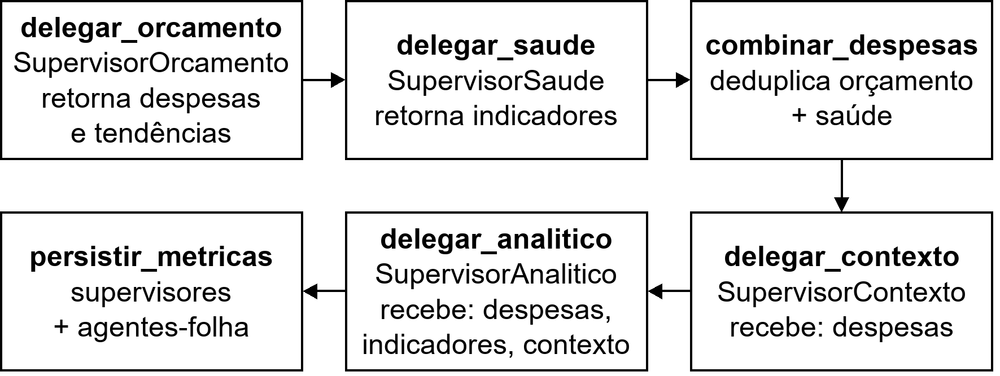
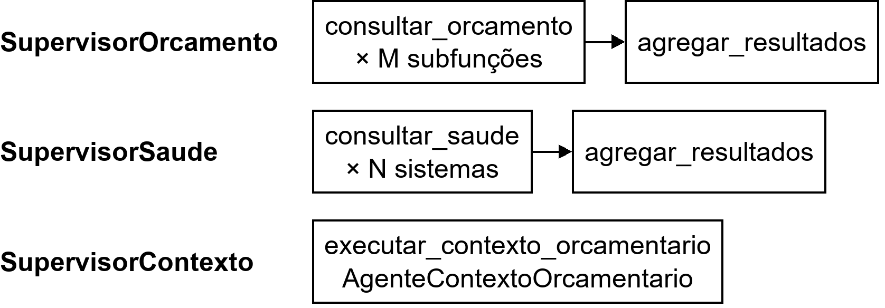
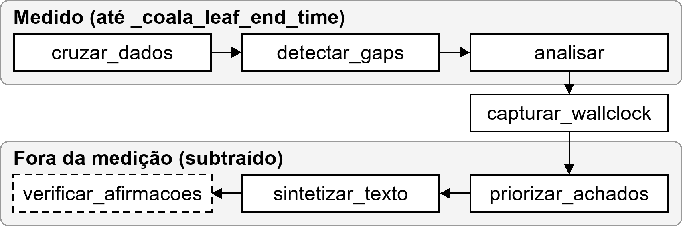
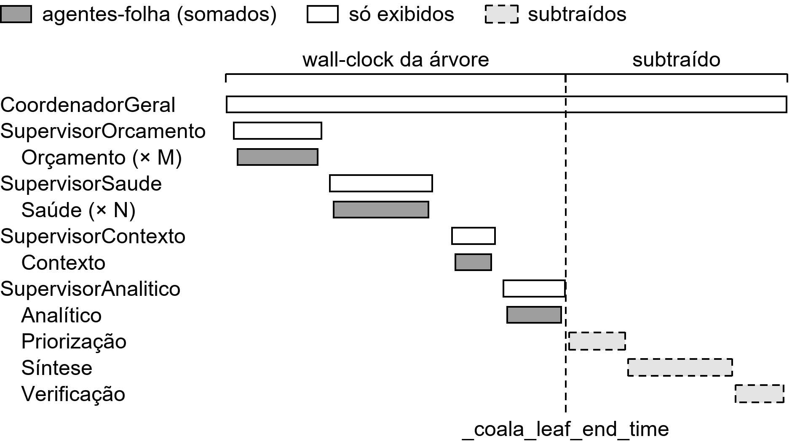
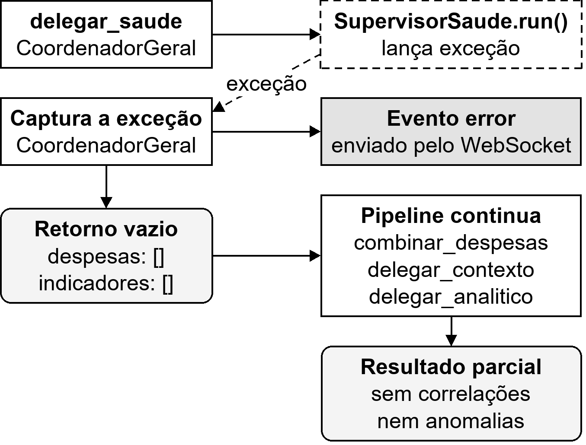

# Arquitetura em Árvore — Ciclo Completo

> Este documento cobre o pipeline interno da topologia em árvore, do momento em que `CoordenadorGeral.run()` é chamado até o resultado final ser retornado. Para a base comum a qualquer agente (ciclo CoALA, chamada ao LLM), ver [agente-coala-e-llm.md](agente-coala-e-llm.md). Para o fluxo de ponta a ponta antes e depois deste pipeline (chat, disparo da análise, WebSocket de resultados), ver [ciclo-completo.md](ciclo-completo.md).

**Arquivos:** `backend/agents/hierarchical/coordinator.py`, `backend/agents/hierarchical/supervisors.py`

> **Nome no código:** no código e na interface, a topologia em árvore aparece como `hierarchical` (módulo `agents/hierarchical/`, chave `hierarchical` nos eventos e no payload, prefixo `hier-` nos IDs) e como "Hierárquica" nos rótulos da tela e no relatório comparativo.

> **Diagramas:** as figuras deste documento ficam em [`docs/diagramas/arquitetura/`](../diagramas/arquitetura/) e [`docs/diagramas/agentes/`](../diagramas/agentes/), em PNG (300 dpi) e SVG, até 16 × 9 cm, com texto em Arial 12 quando inseridas a 100%. Para regenerar: `python docs/diagramas/arquitetura/gerar_diagramas_arquitetura.py` e `python docs/diagramas/agentes/gerar_diagramas_agentes.py`.

## Visão geral

Os agentes ficam em **3 níveis**: um coordenador geral (nível 0), quatro supervisores (nível 1) e os agentes-folha (nível 2). Os agentes-folha são os mesmos da estrela, só que agrupados sob supervisores em vez de reportarem a um hub único.

A estrutura é uma **árvore estrita**: cada supervisor só troca dados com o `CoordenadorGeral`, seu pai, e nunca com outro supervisor. O coordenador colhe o retorno de cada supervisor e repassa o necessário ao próximo como **parâmetro direto** de `run()`.


Os números indicam a ordem em que o coordenador aciona cada supervisor; o passo 3 (`combinar_despesas`) é executado pelo próprio coordenador.

`CoordenadorGeral` e os 4 supervisores herdam de `AgenteCoALA`. Como na estrela, `evaluate_and_select()` é passthrough neles: a ordem é imposta pela dependência de dados. A deliberação real fica nos agentes-folha.

## O pipeline do `CoordenadorGeral`

`run()` instancia os 4 supervisores (`hier-sup-orcamento-…`, `hier-sup-saude-…`, `hier-sup-analitico-…`, `hier-sup-contexto-…`), configura a working memory e delega ao ciclo CoALA:

```python
def propose_actions(self) -> list[dict]:
    if not self.working_memory.get("analysis_id"):
        return []
    return [
        {"goal": "delegar_orcamento"},
        {"goal": "delegar_saude"},
        {"goal": "combinar_despesas"},
        {"goal": "delegar_contexto"},
        {"goal": "delegar_analitico"},
        {"goal": "persistir_metricas"},
    ]
```



A sequência de chamadas deixa explícito que os dados só circulam pela relação pai–filho: cada supervisor devolve seu resultado ao coordenador, que o repassa como parâmetro ao próximo.


### 1. `delegar_orcamento` → `SupervisorOrcamento.run()`

O supervisor ativa as subfunções relevantes aos `health_params` (mesmos critérios da estrela, ver [arquitetura-estrela.md](arquitetura-estrela.md#ativação-condicional)), roda um `AgenteOrcamentoSubfuncao` por subfunção (`consultar_orcamento` × M) e agrega (`agregar_resultados`). Retorna `{despesas, tendencias, agent_queries}`.

### 2. `delegar_saude` → `SupervisorSaude.run()`

Ativa os agentes de saúde pelo mesmo `INDICADOR_TO_AGENT` da estrela (`consultar_saude` × N) e agrega os indicadores. Com `health_params` vazio ativaria todos, mas o agente de intenção nunca envia vazio. Retorna `{indicadores, agent_queries}`. Cada agente faz a sua própria deliberação de dimensão.

### 3. `combinar_despesas`

`deduplicate_despesas(orçamento + saúde)`. Desde a decomposição por sistema, o `SupervisorSaude` nunca retorna despesas, então isto é só uma salvaguarda estrutural.

### 4. `delegar_contexto` → `SupervisorContexto.run(despesas=<combinadas>)`

Delega ao `AgenteContextoOrcamentario` (tendência + CAGR de todas as subfunções presentes). Cálculo determinístico, sem LLM.

### 5. `delegar_analitico` → `SupervisorAnalitico.run(...)`

Recebe como parâmetros diretos as despesas combinadas, os indicadores do `SupervisorSaude`, o contexto orçamentário do `SupervisorContexto`, o período, os `health_params`, o `intent_summary` e as flags `use_llm`/`use_self_check`. Ver a seção dedicada abaixo.

### 6. `persistir_metricas`

Persiste as métricas dos agentes-folha e dos 4 supervisores e emite os eventos `metric` e `agent_data`. Ver [Contabilização](#contabilização-de-métricas-e-overhead).

### O que cada supervisor executa

Cada supervisor também roda o ciclo CoALA, com as próprias ações em `procedural_memory`. Os supervisores de orçamento e de saúde consultam seus agentes e agregam os resultados; o de contexto delega a um único agente:



## O pipeline do `SupervisorAnalitico`

```python
def propose_actions(self) -> list[dict]:
    actions = [
        {"goal": "cruzar_dados"},
        {"goal": "detectar_gaps"},
        {"goal": "analisar"},              # AgenteAnalitico: Spearman + anomalias
        {"goal": "capturar_wallclock"},    # ← marca _coala_leaf_end_time
        {"goal": "priorizar_achados"},     # ← LLM opcional
        {"goal": "sintetizar_texto"},      # ← LLM, streaming
    ]
    if use_self_check and use_llm:
        actions.append({"goal": "verificar_afirmacoes"})
    return actions
```



O mecanismo de cada ação é o mesmo da estrela (ver [arquitetura-estrela.md](arquitetura-estrela.md#o-pipeline-passo-a-passo)). As particularidades desta topologia:

- **`capturar_wallclock`** grava `self._coala_leaf_end_time`. O coordenador usa esse marco como fim da medição do `SupervisorAnalitico`, sem incluir priorização, síntese e verificação.
- **`priorizar_achados`** recebe o `intent_summary` como parâmetro de `run()`, repassado pelo coordenador. O dado atravessa a árvore de cima para baixo, sem canal entre supervisores.

## Contabilização de métricas e overhead

É a parte que mais difere da estrela: existe uma camada real de supervisores, cujo custo precisa ser separado do trabalho de fato.



Cada barra branca de supervisor engloba as barras cinza-escuro dos seus agentes-folha. Só os agentes-folha somam `workers_time_ms`; os supervisores aparecem no breakdown, mas não são somados. Priorização, síntese e verificação, que rodam depois de `_coala_leaf_end_time`, são subtraídas do tempo bruto do coordenador. As durações da figura são ilustrativas.

```python
overhead = wall_clock - soma dos agentes FOLHA (nível 2)
```

- Supervisores aparecem no breakdown **para exibição**, mas **não** são somados em `workers_time_ms`. O tempo de um supervisor já engloba o dos subordinados, e somar os dois contaria o mesmo tempo duas vezes.
- `overhead_ms` (no breakdown como `coordenador_geral`) captura o tempo dos supervisores fora dos subordinados e a instanciação. É a métrica que quantifica o custo de ter uma camada extra de coordenação.
- `sintetizador`, `priorizacao` e `verificacao` ficam fora de `workers_time_ms` e são **subtraídos** do wall-clock. A subtração é explícita porque o coordenador só captura o próprio `time.time()` depois que tudo já rodou:

```python
# CoordenadorGeral._act_persistir_metricas
for agent_mc in sup_analitico._collectors:
    m = agent_mc.collect()
    if m["agentType"] == "sintetizador":   sint_time_ms  = m["executionTimeMs"]
    elif m["agentType"] == "priorizacao":  prior_time_ms = m["executionTimeMs"]
    elif m["agentType"] == "verificacao":  verif_time_ms = m["executionTimeMs"]

wall_clock_ms = max(0, wall_clock_ms_raw - sint_time_ms - prior_time_ms - verif_time_ms)
overhead_ms   = max(0, wall_clock_ms - workers_time_ms)
```

## Degradação graciosa

Cada supervisor pode falhar sozinho, e o coordenador continua com dados parciais para os demais:



No exemplo, o `SupervisorSaude` falha: o coordenador captura a exceção, envia o evento `error` pelo WebSocket, segue com o retorno vazio e entrega um resultado parcial (sem indicadores, não há correlações nem anomalias, mas o texto é gerado mesmo assim).

Os valores vazios usados por supervisor são `{"despesas": [], "tendencias": {}}` (orçamento), `{"despesas": [], "indicadores": []}` (saúde), `{"contexto_orcamentario": {}}` (contexto) e `{"correlacoes": [], "anomalias": [], "texto_analise": ""}` (analítico).

## Retorno

```python
result = dict(analitico_data)   # correlacoes, anomalias, texto_analise, data_coverage, dados_cruzados, self_check
result["despesas"]              = <despesas combinadas>
result["indicadores"]           = saude_data["indicadores"]
result["contexto_orcamentario"] = contexto_data["contexto_orcamentario"]
result["agent_queries"]         = orcamento_data["agent_queries"] + saude_data["agent_queries"]
```

Mesma garantia da estrela: `correlacoes`/`anomalias` no retorno são os dados brutos do `AgenteAnalitico`, nunca a versão reordenada pela priorização. Assim, Q1 compara números idênticos entre as topologias.

## Características-chave desta topologia

- **Árvore estrita**: toda troca de dados passa pela relação pai–filho. Nenhum supervisor conhece ou escreve no estado de outro.
- **Degradação graciosa por camada**: a falha de um supervisor não derruba os demais.
- **Overhead de coordenação mensurável**: `overhead_ms` isola o custo da camada de supervisores.
- **Mais entidades monitoradas**: agentes-folha + 4 supervisores, contra só os agentes-folha na estrela.

> **Histórico — comunicação lateral removida.** Até o commit `38df7be`, os supervisores trocavam dados diretamente entre si (`receive_from_peer`/`peer_data`, inclusive com resumos textuais gerados por LLM, Etapa 5 do [plano de refatoração](../historico/PLANO_REFATORACAO.md)). Mesmo mediada pelo coordenador, essa troca entre nós do mesmo nível fazia a topologia deixar de ser uma árvore no sentido estrito, que é o modelo documentado na literatura e usado como referência no TCC. A troca foi substituída pela passagem de parâmetros pelo coordenador, descrita acima, e a cobertura de testes correspondente está em `backend/tests/test_hierarchical_tree.py`.
