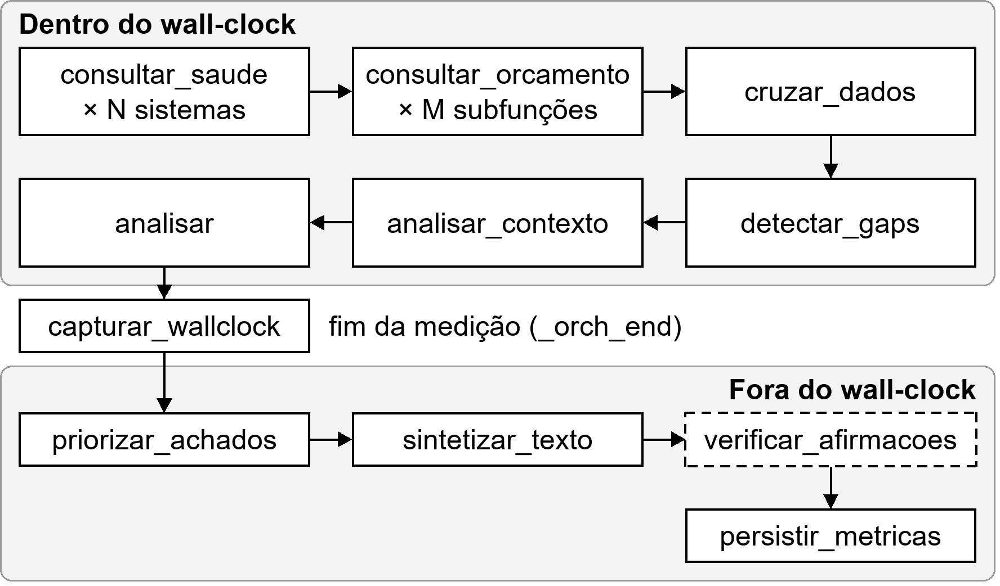
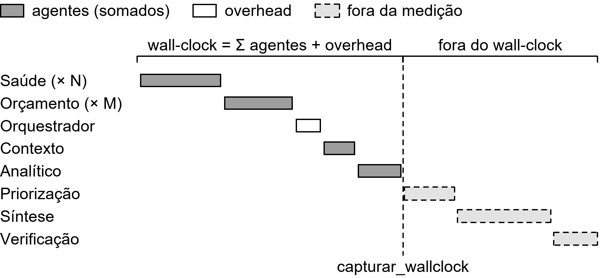

# Arquitetura Estrela — Ciclo Completo

> Este documento cobre o pipeline interno da topologia estrela, do momento em que `OrquestradorEstrela.run()` é chamado até o resultado final ser retornado. Para a base comum a qualquer agente (ciclo CoALA, chamada ao LLM), ver [agente-coala-e-llm.md](agente-coala-e-llm.md). Para o fluxo de ponta a ponta antes e depois deste pipeline (chat, disparo da análise, WebSocket de resultados), ver [ciclo-completo.md](ciclo-completo.md).

**Arquivo:** `backend/agents/star/orchestrator.py`

> **Diagramas:** as figuras deste documento ficam em [`docs/diagramas/arquitetura/`](../diagramas/arquitetura/) e [`docs/diagramas/agentes/`](../diagramas/agentes/), em PNG (300 dpi) e SVG, até 16 × 9 cm, com texto em Arial 12 quando inseridas a 100%. Para regenerar: `python docs/diagramas/arquitetura/gerar_diagramas_arquitetura.py` e `python docs/diagramas/agentes/gerar_diagramas_agentes.py`.

## Visão geral

Um único agente central, o `OrquestradorEstrela`, instancia e chama todos os demais. Nenhum agente periférico se comunica com outro: tudo passa pelo hub. O orquestrador herda de `AgenteCoALA` e executa pelo ciclo CoALA (`run_coala_cycle()`), mas `evaluate_and_select()` é um passthrough aqui: a ordem das macro-ações é imposta por **dependência de dados** (o cruzamento só pode vir depois das consultas, a síntese só depois da análise), e não por arbitragem entre candidatos. A deliberação real acontece nos agentes-folha (escolha de dimensão nos agentes de saúde e de orçamento, escolha de ângulo na priorização).


O orquestrador chama cada grupo de agentes em sequência (a numeração indica a ordem) e recebe o retorno de cada um; as setas duplas representam essa ida e volta.

## Ativação condicional

Só os agentes relevantes aos `health_params` da análise são instanciados. Na prática, esses parâmetros sempre vêm do `AgenteInterpretacaoIntencao`, que nunca os deixa vazios.

**Agentes de saúde**: `INDICADOR_TO_AGENT` (em `semantic_memory`) mapeia cada token para um sistema:

```python
INDICADOR_TO_AGENT = {
    "dengue": "sinan", "chikungunya": "sinan", ...,   # 9 agravos → AgenteSINAN
    "covid": "covid",                                  # → AgenteCOVID (casos + óbitos)
    "internacoes": "sih",
    "vacinacao": "sipni",
    "mortalidade": "sim",
    "nascidos_vivos": "sinasc",
    "producao_ambulatorial": "sia",
    "leitos": "cnes", "profissionais": "cnes", ...,    # 12 subtipos → AgenteCNES
}
```

Os agentes ativos rodam na ordem fixa `covid → sih → sipni → sim → sinan → sinasc → sia → cnes`.

**Agentes de orçamento**: `_SUBFUNCAO_TOKENS` ativa cada subfunção pelos tokens com par temático:

| Subfunção | Ativada por |
|-----------|-------------|
| 122 Administração Geral | Qualquer subtipo do CNES |
| 301 Atenção Básica | `vacinacao` (SI-PNI) |
| 302 Assistência Hospitalar e Ambulatorial | `internacoes` (SIH) |
| 303 Suporte Profilático e Terapêutico | Qualquer agravo do SINAN |
| 304 Vigilância Sanitária | SINAN + `estabelecimentos_vigilancia_epidemiologica` |
| 305 Vigilância Epidemiológica | SINAN + `covid` |
| 306 Alimentação e Nutrição | Qualquer subtipo do CNES |

`mortalidade` também ativa 301, 302, 303 e 305, porque o indicador de mortalidade cruza com o gasto dessas subfunções.

## O pipeline, passo a passo

```python
def propose_actions(self) -> list[dict]:
    actions = []
    for key in _SAUDE_AGENT_KEY_ORDER:                 # só os sistemas ativos
        actions.append({"goal": "consultar_saude", "agent_key": key})
    for codigo, nome in _ORCAMENTO_SUBFUNCOES:         # só as subfunções ativas
        actions.append({"goal": "consultar_orcamento", "subfuncao_codigo": codigo, ...})
    actions.append({"goal": "cruzar_dados"})
    actions.append({"goal": "detectar_gaps"})
    actions.append({"goal": "analisar_contexto"})
    actions.append({"goal": "analisar"})
    actions.append({"goal": "capturar_wallclock"})     # ← fim do trecho determinístico medido
    actions.append({"goal": "priorizar_achados"})      # ← LLM opcional
    actions.append({"goal": "sintetizar_texto"})       # ← LLM
    if use_self_check and use_llm:
        actions.append({"goal": "verificar_afirmacoes"})   # ← LLM
    actions.append({"goal": "persistir_metricas"})
    return actions
```

`execute()`, herdado da base, percorre a lista em ordem e chama o `_act_*` de cada goal. A figura abaixo mostra a mesma sequência, separando o que entra no wall-clock do que fica fora dele:



### 1. `consultar_saude` (uma vez por sistema ativo)

`_act_consultar_saude` instancia o agente do sistema (`AgenteSINAN`, `AgenteSIH`…), chama `agent.query(analysis_id, date_from, date_to, intent_summary=..., use_llm=...)` e acumula `working_memory["indicadores"]`. Cada `query()` roda o ciclo CoALA do próprio agente, incluindo a **deliberação de dimensão** (ver [02-AGENTES.md](../02-AGENTES.md#deliberação-de-dimensão)). As consultas Cypher do `neo4j_client.query_log` ficam registradas em `agent_queries`, exibidas na aba técnica.

### 2. `consultar_orcamento` (uma vez por subfunção ativa)

Instancia `AgenteOrcamentoSubfuncao(codigo, nome)`, que delibera a dimensão das despesas e também classifica a tendência e lê `VARIACAO_ANUAL`. Acumula `despesas`, `tendencias[codigo]` e `variacao_anual[codigo]`.

Se um agente falha (de saúde ou de orçamento), o hub envia um evento `error` pelo `ws_queue` e **segue** com dados parciais.

### 3. Cruzamento e transparência

- `cruzar_dados`: `deduplicate_despesas` + `cross_domain_data()` cruzam despesas × indicadores por subfunção e ano, conforme `SUBFUNCAO_INDICADOR_MAP`.
- `detectar_gaps`: `detect_data_gaps()` gera `data_coverage` (anos sem despesa ou sem indicador), para o texto mencionar o que falta.

### 4. Fase analítica (determinística)

- `analisar_contexto`: `AgenteContextoOrcamentario.analyze_trends(despesas)` calcula a tendência e o CAGR por subfunção.
- `analisar`: `AgenteAnalitico.analisar(dados_cruzados)` calcula as correlações de Spearman e as anomalias por mediana.

Nenhuma dessas ações usa LLM.

### 5. `capturar_wallclock`: a fronteira antes do LLM

```python
def _act_capturar_wallclock(self, action: dict) -> None:
    self.working_memory["_orch_end"] = time.time()
```

Tudo o que roda **depois** deste ponto envolve LLM e fica **fora** do wall-clock usado para comparar as topologias. A latência da API não deve contaminar a métrica de eficiência da arquitetura.

### 6. `priorizar_achados`

Delega a `AgentePriorizacaoAnalitica.prioritize(correlacoes, anomalias, contexto_orcamentario, intent_summary, use_llm=...)`, que escolhe o ângulo de ênfase e **reordena**, sem nunca filtrar, as listas. O resultado fica em `working_memory["achados_priorizados"]`. Uma falha aqui só gera um warning, e o sintetizador segue com os dados brutos.

### 7. `sintetizar_texto`

Delega ao `TextSynthesizer`, que é um serviço e não um agente CoALA. Usa os achados priorizados (com o ângulo como `enfase`) se existirem, e os dados brutos caso contrário.

```
use_llm=True:
    generate_stream(...) → StreamingAdapter.stream_tokens → eventos "chunk" no ws_queue
        └── vazio/falha → generate_fallback(...) (texto estruturado determinístico)
use_llm=False:
    generate_fallback(...) direto
```

### 8. `verificar_afirmacoes` (opcional)

Só é proposta com `use_self_check=True` e `use_llm=True`. Aplica `core/claim_verifier.self_check()` (extrair → verificar contra os dados brutos → revisar uma vez) e substitui o texto final se houver correção. O detalhe vai em `result["self_check"]`. Nunca propaga falha.

### 9. `persistir_metricas`

Persiste `MetricaExecucao` (tempo e CPU) de cada agente no Neo4j e emite dois eventos no `ws_queue`: `metric` (breakdown agregado) e `agent_data` (consultas por agente).



As barras cinza-escuro (agentes) somam `workers_time_ms`; o restante do wall-clock, até `capturar_wallclock`, é o overhead do orquestrador (cruzamento, detecção de lacunas, instanciação). Priorização, síntese e verificação rodam depois da fronteira e ficam fora da medição. As durações da figura são ilustrativas.

```python
for _, agent_type, mc in collectors:
    if agent_type in ("sintetizador", "priorizacao", "verificacao"):
        continue                         # rodam depois de capturar_wallclock, com LLM
    workers_time_ms += m["executionTimeMs"]

wall_clock_ms = (_orch_end - _orch_start) * 1000
overhead_ms   = max(0, wall_clock_ms - workers_time_ms)   # entra no breakdown como "orquestrador_estrela"
```

## Retorno

```python
result = {
    "despesas": [...], "indicadores": [...], "dados_cruzados": [...],
    "contexto_orcamentario": {...}, "correlacoes": [...], "anomalias": [...],
    "texto_analise": "...", "data_coverage": {...},
    "self_check": {...} | None, "agent_queries": [...],
}
```

`correlacoes`/`anomalias` são sempre os dados **brutos**, nunca a versão reordenada pela priorização. É isso que garante que a métrica Q1 (consistência determinística entre estrela e árvore) compare exatamente os mesmos números, qualquer que seja o ângulo escolhido por cada topologia.

## Características-chave desta topologia

- **Ponto único de coordenação**: se o próprio orquestrador falha, a análise inteira falha.
- **Comunicação simples**: sempre hub ↔ agente, ida e volta.
- **Ativação condicional**: só instancia os agentes de saúde e de orçamento necessários.
- **Sem camada intermediária**: o custo de coordenar está embutido no próprio orquestrador, e o `overhead_ms` tende a ser pequeno.
